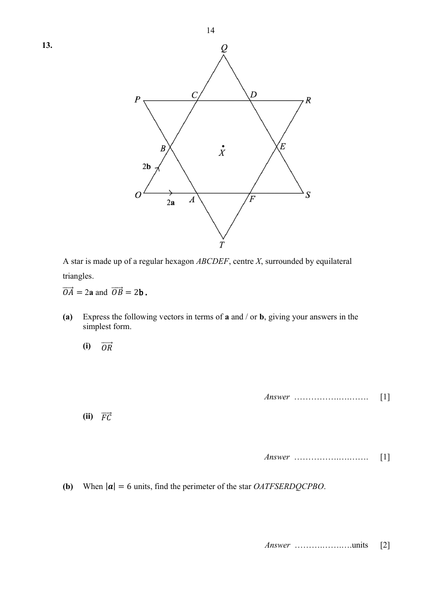

## Question

> **Marks:** (a)(i) 1, (a)(ii) 1, (b) 2; total 4
> **Page:** 14

A star is made up of a regular hexagon $ABCDEF$, centre $X$, surrounded by equilateral triangles. $\overrightarrow{OA} = 2\mathbf{a}$ and $\overrightarrow{OB} = 2\mathbf{b}$.

**(a)** Express the following vectors in terms of $\mathbf{a}$ and/or $\mathbf{b}$, giving your answers in the simplest form.

**(i)** $\overrightarrow{OR}$ [1]

**(ii)** $\overrightarrow{FC}$ [1]

**(b)** When $|\mathbf{a}| = 6$ units, find the perimeter of the star $OATFSERDQCPBO$. [2]

## Answer Scheme

A star is made up of a regular hexagon $ABCDEF$, centre $X$, surrounded by equilateral triangles. $\overrightarrow{OA}=2\mathbf{a}$ and $\overrightarrow{OB}=2\mathbf{b}$.

**(a)** Express the following vectors in terms of $\mathbf{a}$ and/or $\mathbf{b}$, giving your answers in the simplest form.

**(i)** $\overrightarrow{OR}$

$$
\begin{aligned}
\overrightarrow{OR}&=\overrightarrow{OA}+\overrightarrow{AF}+\overrightarrow{FE}+\overrightarrow{ER}\\
\overrightarrow{OR}&=4\mathbf{a}+4\mathbf{b}
\end{aligned}
$$

**(ii)** $\overrightarrow{FC}$

$$
\begin{aligned}
\overrightarrow{FC}&=\overrightarrow{FE}+\overrightarrow{ER}+\overrightarrow{RD}+\overrightarrow{DC}\\
\overrightarrow{FC}&=4\mathbf{b}-4\mathbf{a}
\end{aligned}
$$

**(b)** When $|\mathbf{a}|=6$ units, find the perimeter of the star $OATFSERDQCPBO$.

$$
\begin{aligned}
\text{Perimeter of the star}&=12(2\times 6)\\
&=144\text{ units}
\end{aligned}
$$
