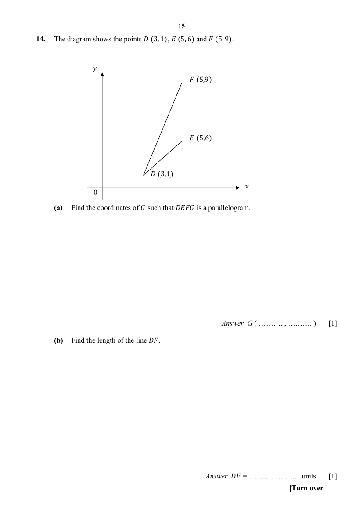

## Question

> **Marks:** (a) 1, (b) 1; total 2
> **Page:** 15

The diagram shows the points $D(3,1)$, $E(5,6)$ and $F(5,9)$.

**(a)** Find the coordinates of $G$ such that $DEFG$ is a parallelogram. [1]

**(b)** Find the length of the line $DF$. [1]

## Answer Scheme

The diagram shows the points $D(3,1)$, $E(5,6)$ and $F(5,9)$.

**(a)** Find the coordinates of $G$ such that $DEFG$ is a parallelogram.

$G(3,4)$

**(b)** Find the length of the line $DF$.

$$
\begin{aligned}
DF&=\sqrt{(5-3)^{2}+(9-1)^{2}}\\
&=8.2462\\
&=8.25\text{ units}\ (3\text{ s.f.})
\end{aligned}
$$
