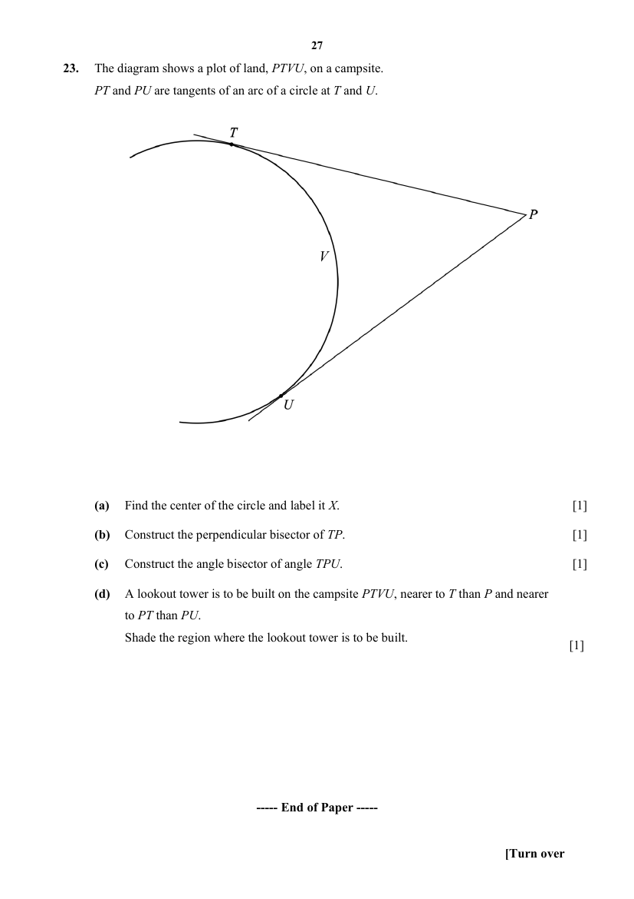
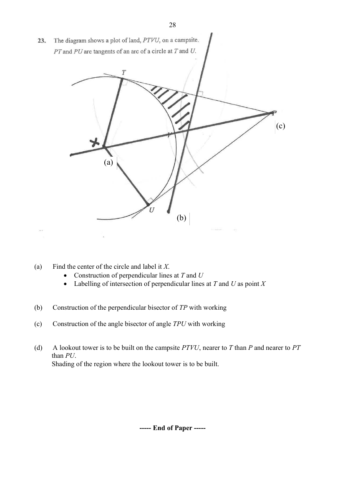

## Question

> **Marks:** (a) 1, (b) 1, (c) 1, (d) 1; total 4
> **Page:** 27

The diagram shows a plot of land, $PTVU$, on a campsite. $PT$ and $PU$ are tangents of an arc of a circle at $T$ and $U$.

**(a)** Find the centre of the circle and label it $X$. [1]

**(b)** Construct the perpendicular bisector of $TP$. [1]

**(c)** Construct the angle bisector of angle $TPU$. [1]

**(d)** A lookout tower is to be built on the campsite $PTVU$, nearer to $T$ than $P$ and nearer to $PT$ than $PU$. Shade the region where the lookout tower is to be built. [1]

## Answer Scheme

The diagram shows a plot of land, $PTVU$, on a campsite. $PT$ and $PU$ are tangents of an arc of a circle at $T$ and $U$.

**(a)** Find the centre of the circle and label it $X$.

Construction of perpendicular lines at $T$ and $U$. Labelling of the intersection of the perpendicular lines at $T$ and $U$ as point $X$.

**(b)** Construct the perpendicular bisector of $TP$.

Construction of the perpendicular bisector of $TP$ with working.

**(c)** Construct the angle bisector of angle $TPU$.

Construction of the angle bisector of angle $TPU$ with working.

**(d)** A lookout tower is to be built on the campsite $PTVU$, nearer to $T$ than $P$ and nearer to $PT$ than $PU$.

Shade the region where the lookout tower is to be built.

