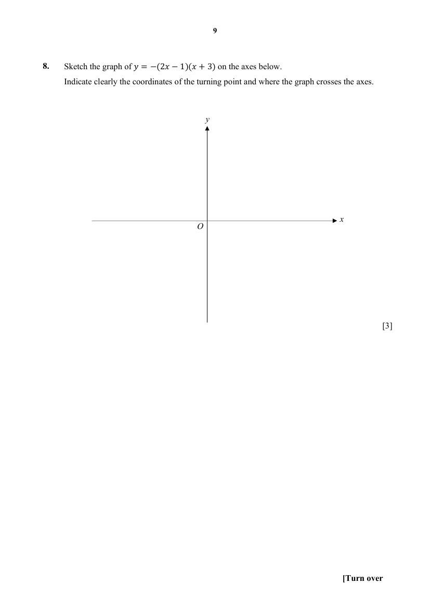
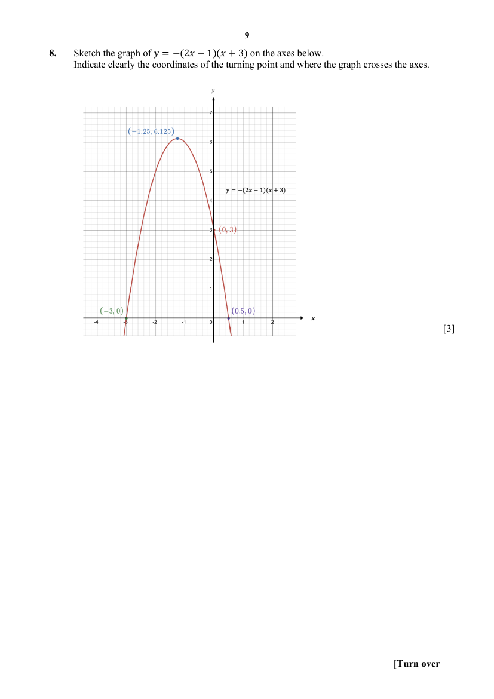

## Question

> **Marks:** 3
> **Page:** 9

Sketch the graph of $y = -(2x-1)(x+3)$ on the axes below. Indicate clearly the coordinates of the turning point and where the graph crosses the axes. [3]

## Answer Scheme

Sketch the graph of $y=-(2x-1)(x+3)$ on the axes below. Indicate clearly the coordinates of the turning point and where the graph crosses the axes.

The curve crosses the $x$-axis at $(-3,0)$ and $(0.5,0)$, crosses the $y$-axis at $(0,3)$, and has turning point $(-1.25,6.125)$.

