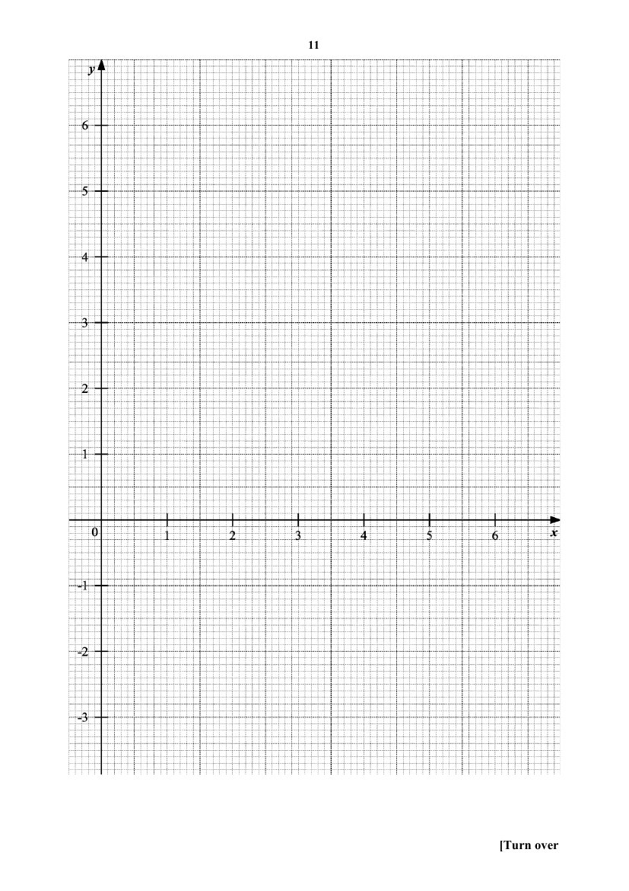

## Question

> **Marks:** (a) [1]; (b) [2]; (c) [1]; (d)(i) [2]; (d)(ii) [2]; (d)(iii) [3]; total [11]
> **Page:** 10–12

**(a)** Complete the table of values for $y=\dfrac{x^{2}}{7}+\dfrac{2}{x}-5$. Values are given to one decimal place where appropriate. [1]

| $x$ | $0.2$ | $0.5$ | $1$ | $2$ | $3$ | $4$ | $5$ | $6$ |
| --- | --- | --- | --- | --- | --- | --- | --- | --- |
| $y$ |  | $-1.0$ | $-2.9$ | $-3.4$ | $-3.0$ | $-2.2$ | $-1.0$ | $0.5$ |

**(b)** On the grid opposite, draw the graph of $y=\dfrac{x^{2}}{7}+\dfrac{2}{x}-5$ for $0<x\leq 6$. [2]

**(c)** Use your graph to write down an inequality in $x$ to describe the range of values where $y<-2$. [1]

**(d) (i)** On the same grid, draw the graph of $2y+4x=9$ for $0<x\leq 6$. [2]

**(ii)** Write down the $x$-coordinates of the points where the line intersects the curve. [2]

**(iii)** These values of $x$ are the solutions of the equation $2x^{3}+Ax^{2}-Bx+28=0$. Find the value of $A$ and the value of $B$. [3]

## Answer Scheme

**(a)** When $x=0.2$, $y=5.0$ ($1$ d.p.).

**(b)** Points plotted correctly. Smoothness of curve and label.

**(c)** $0.7<x<4.2$ ($\pm 0.1$).

**(d) (i)** At least $3$ plotted points. Graph and label.

**(ii)** $x=0.2$ or $x=3.55$ ($\pm 0.1$).

**(iii)**

$$
\begin{aligned}
\dfrac{x^{2}}{7}+\dfrac{2}{x}-5&=-2x+\dfrac{9}{2}\\
2x^{3}+28-70x&=-28x^{2}+63x\\
2x^{3}+28x^{2}-133x+28&=0\\
A&=28,\quad B=133
\end{aligned}
$$
