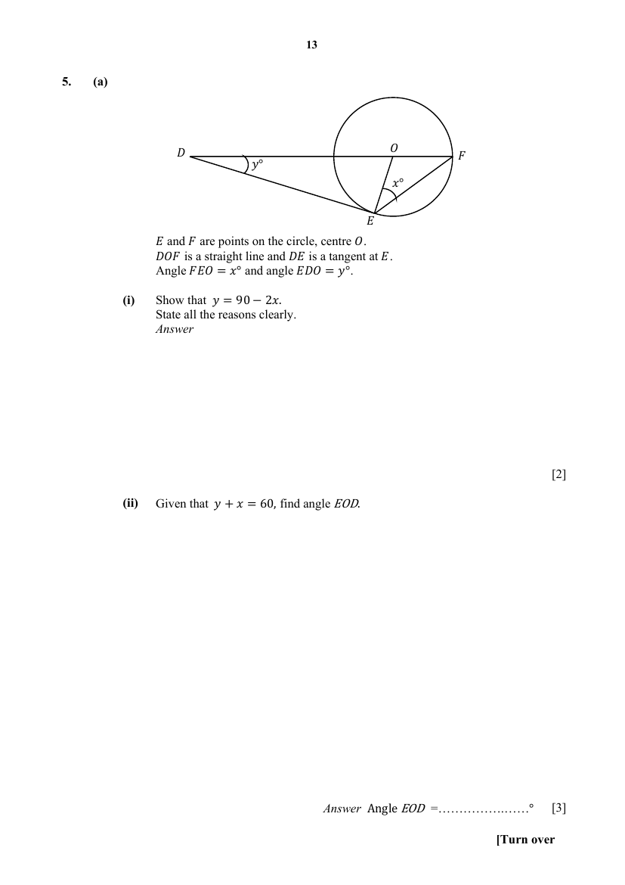
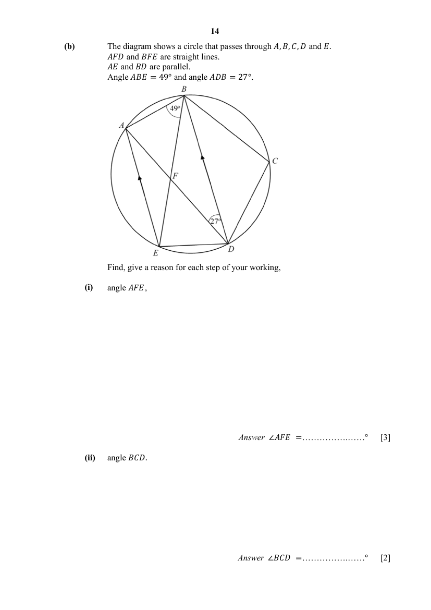

## Question

> **Marks:** (a)(i) [2]; (a)(ii) [3]; (b)(i) [3]; (b)(ii) [2]; total [10]
> **Page:** 13–14

**(a)** $E$ and $F$ are points on the circle, centre $O$. $DOF$ is a straight line and $DE$ is a tangent at $E$. Angle $FEO=x^{\circ}$ and angle $EDO=y^{\circ}$.

**(i)** Show that $y=90-2x$. State all the reasons clearly. [2]

**(ii)** Given that $y+x=60$, find angle $EOD$. [3]

**(b)** The diagram shows a circle that passes through $A$, $B$, $C$, $D$ and $E$. $AFD$ and $BFE$ are straight lines. $AE$ and $BD$ are parallel. Angle $ABE=49^{\circ}$ and angle $ADB=27^{\circ}$.

Find, give a reason for each step of your working,

**(i)** angle $AFE$, [3]

**(ii)** angle $BCD$. [2]

## Answer Scheme

**(a) (i)**

$\angle OFE=x^{\circ}$ (base angles of isosceles triangle since $OE$ and $OF$ are radii of the same circle).

$\angle OED=90^{\circ}$ (tangent to a circle).

$$
\begin{aligned}
y+90+x+x&=180\quad(\text{angle sum of triangle})\\
y&=90-2x\quad(\text{shown})
\end{aligned}
$$

**(ii)**

$$
\begin{aligned}
y&=90-2x\\
y+x&=60\\
90-2x+x&=60\\
x&=30,\quad y=30\\
\angle EOD&=90^{\circ}-y^{\circ}\\
\angle EOD&=90^{\circ}-30^{\circ}=60^{\circ}
\end{aligned}
$$

**(b) (i)**

$\angle AEB=\angle ADB=27^{\circ}$ (angles in the same segment).

$\angle EAD=\angle ADB=27^{\circ}$ (alternate angles, $BD$ parallel to $AE$).

$$
\begin{aligned}
\angle AFE+\angle AEB+\angle EAD&=180^{\circ}\quad(\text{angle sum of triangle})\\
\angle AFE&=126^{\circ}
\end{aligned}
$$

**(ii)**

$$
\begin{aligned}
\angle AFE&=\angle DAB+\angle ABE\quad(\text{exterior angle})\\
\angle DAB&=126^{\circ}-49^{\circ}=77^{\circ}\\
\angle BCD&=180^{\circ}-\angle DAB\quad(\text{opposite angles of a cyclic quadrilateral})\\
&=180^{\circ}-77^{\circ}\\
&=103^{\circ}
\end{aligned}
$$
