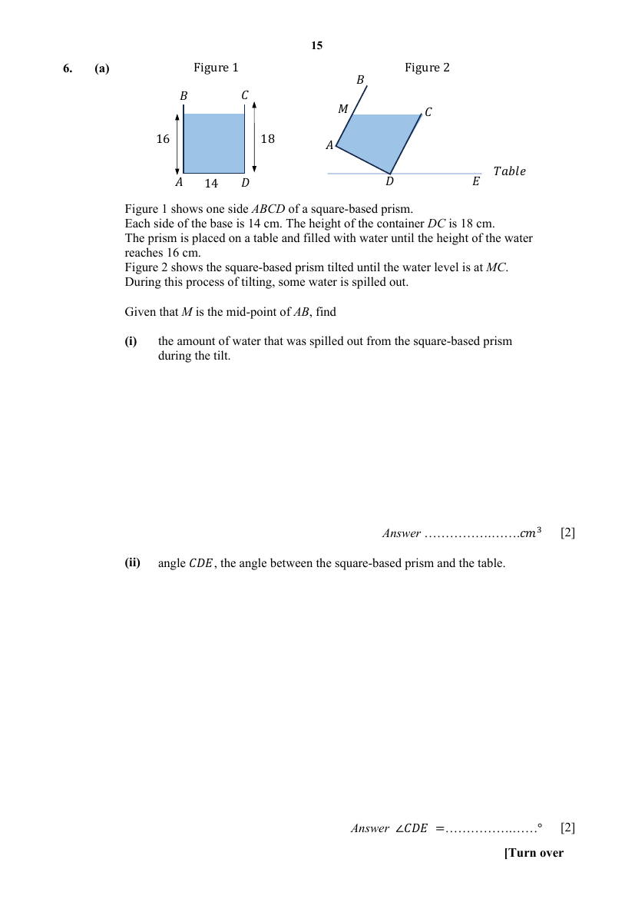
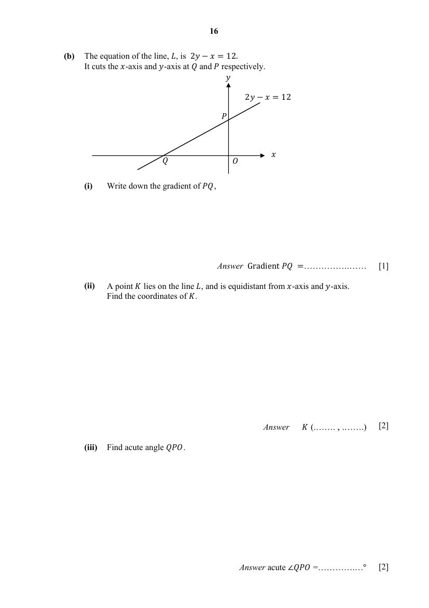

## Question

> **Marks:** (a)(i) [2]; (a)(ii) [2]; (b)(i) [1]; (b)(ii) [2]; (b)(iii) [2]; total [9]
> **Page:** 15–16

**(a)** Figure 1 shows one side $ABCD$ of a square-based prism. Each side of the base is $14$ cm. The height of the container $DC$ is $18$ cm. The prism is placed on a table and filled with water until the height of the water reaches $16$ cm. Figure 2 shows the square-based prism tilted until the water level is at $MC$. During this process of tilting, some water is spilled out.

Given that $M$ is the mid-point of $AB$, find

**(i)** the amount of water that was spilled out from the square-based prism during the tilt, [2]

**(ii)** angle $CDE$, the angle between the square-based prism and the table. [2]

**(b)** The equation of the line, $L$, is $2y-x=12$. It cuts the $x$-axis and $y$-axis at $Q$ and $P$ respectively.

**(i)** Write down the gradient of $PQ$, [1]

**(ii)** A point $K$ lies on the line $L$, and is equidistant from $x$-axis and $y$-axis. Find the coordinates of $K$. [2]

**(iii)** Find acute angle $QPO$. [2]

## Answer Scheme

**(a) (i)**

$$
\begin{aligned}
\text{Amount of water spilled}&=14^{2}\times 16-\dfrac{1}{2}(9+18)\times 14\times 14\\
&=3136-2646\\
&=490\ \mathrm{cm}^{3}
\end{aligned}
$$

**(ii)**

$$
\begin{aligned}
\angle MCD&=\tan^{-1}\left(\dfrac{14}{18-9}\right)=57.264^{\circ}\\
\angle CDE&=\angle MCD=57.3^{\circ}\ (1\text{ d.p.})
\end{aligned}
$$

Alternate angles, $MC$ parallel to $DE$. The water level is parallel to the surface of the table. $18-9=9$.

**(b) (i)**

$$
\begin{aligned}
2y-x&=12\\
y&=\dfrac{1}{2}x+6
\end{aligned}
$$

Gradient of $PQ=\dfrac{1}{2}$.

**(ii)** Two possibilities.

Since the point is equidistant from the $x$-axis and the $y$-axis, either $x=-y$ or $x=y$.

$$
\begin{aligned}
2y-(-y)&=12\\
3y&=12\\
y&=4,\quad x=-4\\
K&=(-4,4)
\end{aligned}
$$

$$
\begin{aligned}
2y-y&=12\\
y&=12,\quad x=12\\
K&=(12,12)
\end{aligned}
$$

**(iii)**

$$
\begin{aligned}
\tan\angle QPO&=\dfrac{OQ}{OP}=\dfrac{12}{6}=2\\
\text{acute }\angle QPO&=63.4^{\circ}\ (1\text{ d.p.})
\end{aligned}
$$
