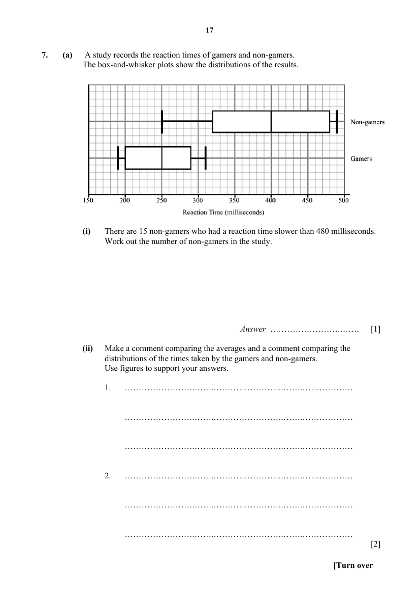

## Question

> **Marks:** (a)(i) [1]; (a)(ii) [2]; (b)(i) [3]; (b)(ii) [2]; (b)(iii) [2]; total [10]
> **Page:** 17–18

**(a)** A study records the reaction times of gamers and non-gamers. The box-and-whisker plots show the distributions of the results.

**(i)** There are $15$ non-gamers who had a reaction time slower than $480$ milliseconds. Work out the number of non-gamers in the study. [1]

**(ii)** Make a comment comparing the averages and a comment comparing the distributions of the times taken by the gamers and non-gamers. Use figures to support your answers. [2]

**(b)** Three boxes, X, Y and Z contain the following balls.

Box X: $2$ black balls and $1$ white ball.

Box Y: $1$ black ball and $5$ white balls.

Box Z: $2$ black balls and $2$ white balls.

A ball is picked at random from a box. The box is chosen by throwing a die and applying the following rules.

1. If the outcome on the die is $6$, box X will be chosen.
2. If the outcome on the die is a $4$ or a $5$, box Y will be chosen.
3. If the outcome on the die is a $1$, a $2$ or a $3$, box Z will be chosen.

If a black ball is obtained, a prize of SGD 10 is awarded. There will be a SGD 2 fee to play the game.

**(i)** Complete the tree diagram. [3]

**(ii)** Find the probability of winning the SGD 10 prize. [2]

**(iii)** Find the amount gained or lost after playing $12$ games. [2]

## Answer Scheme

**(a) (i)**

$$
15\times\dfrac{4}{3}=20
$$

**(ii)** Gamers have a lower median of $250$ milliseconds compared to $400$ milliseconds for non-gamers. Hence, gamers generally had faster reaction times.

The interquartile range for gamers of $290-200=90$ milliseconds is smaller than that for non-gamers of $480-320=160$ milliseconds. Hence, non-gamers had a wider spread in reaction times, showing less consistency.

**(b) (i)** Tree diagram probabilities:

| Branch | Probability |
| --- | --- |
| Die to box X | $\dfrac{1}{6}$ |
| Box X, black | $\dfrac{2}{3}$ |
| Box X, white | $\dfrac{1}{3}$ |
| Die to box Y | $\dfrac{1}{3}$ |
| Box Y, black | $\dfrac{1}{6}$ |
| Box Y, white | $\dfrac{5}{6}$ |
| Die to box Z | $\dfrac{1}{2}$ |
| Box Z, black | $\dfrac{1}{2}$ |
| Box Z, white | $\dfrac{1}{2}$ |

**(ii)**

$$
\begin{aligned}
\dfrac{1}{6}\times\dfrac{2}{3}+\dfrac{1}{3}\times\dfrac{1}{6}+\dfrac{1}{2}\times\dfrac{1}{2}&=\dfrac{5}{12}
\end{aligned}
$$

**(iii)** $5$ wins in $12$ games gains SGD 50. Fee incurred $=SGD 2\times 12=SGD 24$. Amount earned $=SGD 50-SGD 24=SGD 26$ gained.
