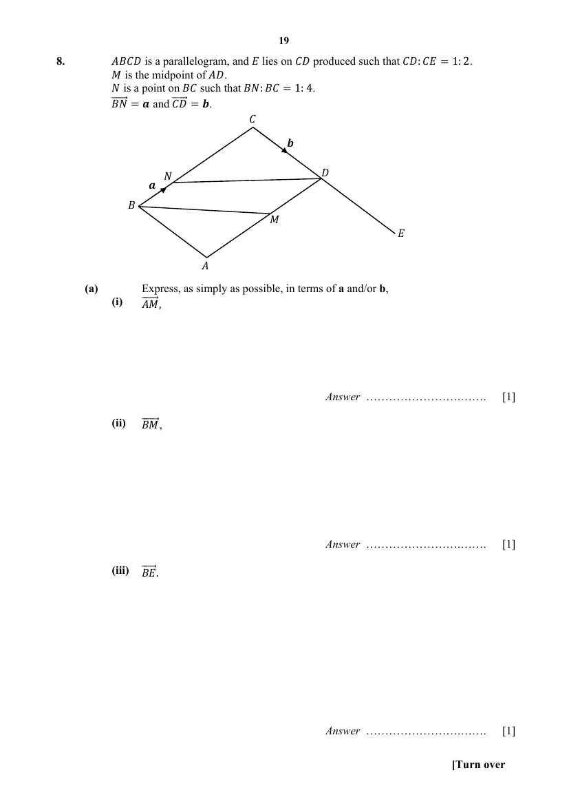

## Question

> **Marks:** (a)(i) [1]; (a)(ii) [1]; (a)(iii) [1]; (b) [2]; (c)(i) [1]; (c)(ii) [2]; total [8]
> **Page:** 19–20

$ABCD$ is a parallelogram, and $E$ lies on $CD$ produced such that $CD:CE=1:2$. $M$ is the midpoint of $AD$. $N$ is a point on $BC$ such that $BN:BC=1:4$. $\overrightarrow{BN}=\mathbf{a}$ and $\overrightarrow{CD}=\mathbf{b}$.

**(a)** Express, as simply as possible, in terms of $\mathbf{a}$ and/or $\mathbf{b}$,

**(i)** $\overrightarrow{AM}$, [1]

**(ii)** $\overrightarrow{BM}$, [1]

**(iii)** $\overrightarrow{BE}$. [1]

**(b)** Explain why $B$, $M$ and $E$ lie on a straight line. [2]

**(c)** Find the numerical value of

**(i)** $\dfrac{\text{Area of triangle }AMB}{\text{Area of triangle }DCN}$, [1]

**(ii)** $\dfrac{\text{Area of triangle }EDM}{\text{Area of }DCBM}$. [2]

## Answer Scheme

**(a) (i)**

$$
\begin{aligned}
\overrightarrow{AM}&=\dfrac{1}{2}\overrightarrow{AD}=\dfrac{1}{2}\overrightarrow{BC}=\dfrac{1}{2}(4\mathbf{a})\\
\overrightarrow{AM}&=2\mathbf{a}
\end{aligned}
$$

$ABCD$ is a parallelogram.

**(ii)**

$$
\begin{aligned}
\overrightarrow{BM}&=\overrightarrow{BA}+\overrightarrow{AM}\\
\overrightarrow{BM}&=2\mathbf{a}+\mathbf{b}
\end{aligned}
$$

**(iii)**

$$
\begin{aligned}
\overrightarrow{BE}&=\overrightarrow{BC}+\overrightarrow{CE}\\
\overrightarrow{BE}&=4\mathbf{a}+2\mathbf{b}
\end{aligned}
$$

**(b)**

$$
\begin{aligned}
\overrightarrow{BM}&=2\mathbf{a}+\mathbf{b}\\
\overrightarrow{BE}&=4\mathbf{a}+2\mathbf{b}=2(2\mathbf{a}+\mathbf{b})=2\overrightarrow{BM}
\end{aligned}
$$

Since $\overrightarrow{BE}=2\overrightarrow{BM}$ and $B$ is a common point, $B$, $M$ and $E$ lie on a straight line.

**(c) (i)** $ABCD$ is a parallelogram. Let $h$ be the perpendicular height between $AD$ and $BC$.

$$
\dfrac{\text{Area of triangle }AMB}{\text{Area of triangle }DCN}=\dfrac{AM}{NC}=\dfrac{2}{3}
$$

**(ii)**

$$
\begin{aligned}
\dfrac{\text{Area of triangle }EDM}{\text{Area of triangle }ECB}&=\dfrac{1}{4}\\
\dfrac{\text{Area of triangle }EDM}{\text{Area of }DCBM}&=\dfrac{1}{3}
\end{aligned}
$$
