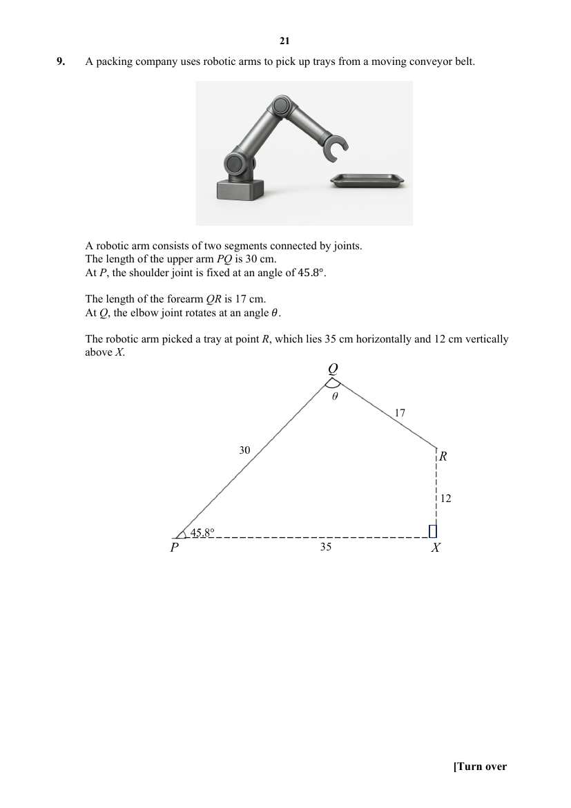

## Question

> **Marks:** (a) [2]; (b) [1]; (c) [7]; total [10]
> **Page:** 21–24

A packing company uses robotic arms to pick up trays from a moving conveyor belt.

A robotic arm consists of two segments connected by joints. The length of the upper arm $PQ$ is $30$ cm. At $P$, the shoulder joint is fixed at an angle of $45.8^{\circ}$. The length of the forearm $QR$ is $17$ cm. At $Q$, the elbow joint rotates at an angle $\theta$.

The robotic arm picked a tray at point $R$, which lies $35$ cm horizontally and $12$ cm vertically above $X$.

**(a)** Calculate angle $\theta$, that allows for the arm to pick the tray at $R$. [2]

**(b)** Due to calibration errors, there may be a $1^{\circ}$ change in $\theta$. Show that a $1^{\circ}$ change in $\theta$ will lead to $0.297$ cm difference from the intended position of $R$. [1]

**(c)** The company is deciding whether to adopt a new system that uses camera feedback to calculate the joint angle $\theta$ in real time.

They are considering two new systems B and C.

| System | Description |
| --- | --- |
| System A (Original) | Uses pre-programmed joint angle $\theta$. There is a $40\%$ chance that a $1^{\circ}$ error in $\theta$ will occur, which causes the arm to not be able to pick up the tray. |
| System B (Real-time) | Uses real-time camera feedback to recalculate $\theta$ for every tray. The angle is always accurate. |
| System C (Hybrid) | Uses pre-programmed joint angle $\theta$. When a $1^{\circ}$ error in $\theta$ is detected, it uses real-time camera feedback to recalculate the angle $\theta$. |

Additional notes:

- Using the original system, the robot handles $300$ trays per hour.
- Each successful tray earns the company SGD 0.50 revenue.
- A $1^{\circ}$ error in $\theta$ leads to a miss, as the arm cannot pick up the tray.
- Each missed tray incurs a SGD 0.30 cost.
- Using the camera feedback introduces a $0.4$ second delay per tray.
- There is a fixed monthly cost of SGD 12 000 for using the camera feedback.
- The company operates $160$ hours per month.

Determine which system the company should adopt. Justify the decision you make and show your calculations clearly. [7]

## Answer Scheme

**(a)**

$$
\begin{aligned}
PR&=\sqrt{35^{2}+12^{2}}=37\ \mathrm{cm}\\
\angle PQR&=\cos^{-1}\left(\dfrac{30^{2}+17^{2}-37^{2}}{2(30)(17)}\right)\\
\theta&=100.2^{\circ}\ (1\text{ d.p.})
\end{aligned}
$$

**(b)**

$$
\begin{aligned}
\text{Arc length}&=\dfrac{1^{\circ}}{360^{\circ}}\times 2\pi(17)\\
&=0.297\ \mathrm{cm}\ (3\text{ significant figures})
\end{aligned}
$$

**(c)**

|  | A (Original) | B (Real-time) | C (Hybrid) |
| --- | --- | --- | --- |
| Trays per hour | Missed trays $=40\%\times 300=120$. Successful trays $=\dfrac{60}{100}\times 300=180$. | Time for one tray $=\dfrac{3600}{300}=12$ s. New time $=12.4$ s. Successful trays $=\dfrac{3600}{12.4}=290$ (nearest whole number). | Successful trays $=180$. Time for those trays $=\dfrac{3600}{300}\times 180=2160$ s. Trays after recalculation $=\dfrac{3600-2160}{12.4}=116$. Total trays $=180+116=296$. |
| Revenue per hour | $180\times SGD 0.50=SGD 90$ | $290\times SGD 0.50=SGD 145$ | $296\times SGD 0.50=SGD 148$ |
| Missed cost per hour | $120\times SGD 0.30=SGD 36$ | SGD 0 | SGD 0 |
| Camera cost per hour | SGD 0 | $\dfrac{SGD 12000}{160}=SGD 75$ | $\dfrac{SGD 12000}{160}=SGD 75$ |
| Net profit per hour | $SGD 90-SGD 36=SGD 54$ | $SGD 145-SGD 75=SGD 70$ | $SGD 148-SGD 75=SGD 73$ |
| Monthly profit | $SGD 54\times 160=SGD 8640$ | $SGD 70\times 160=SGD 11200$ | $SGD 73\times 160=SGD 11680$ |

Since System C generates the most profit, the company should adopt System C.
