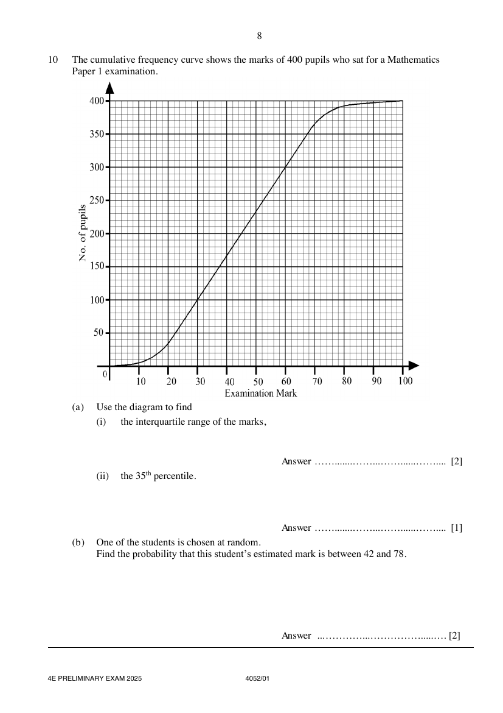

## Question

> **Marks:** (a)(i) 2, (a)(ii) 1, (b) 2; total 5
> **Page:** 8

The cumulative frequency curve shows the marks of 400 pupils who sat for a Mathematics Paper 1 examination.

**(a)** Use the diagram to find

**(i)** the interquartile range of the marks, [2]

**(ii)** the $35^{\text{th}}$ percentile. [1]

**(b)** One of the students is chosen at random.
Find the probability that this student's estimated mark is between 42 and 78. [2]

## Answer Scheme

**(a) (i)** the interquartile range of the marks,

$$
60-30=30
$$

**(a) (ii)** the $35^{\text{th}}$ percentile.

$$
36\text{ marks}
$$

**(b)** Find the probability that this student's estimated mark is between 42 and 78.

$$
\frac{390-180}{400}=\frac{21}{40}
$$

Accept $0.525$ and $52.5\%$.
