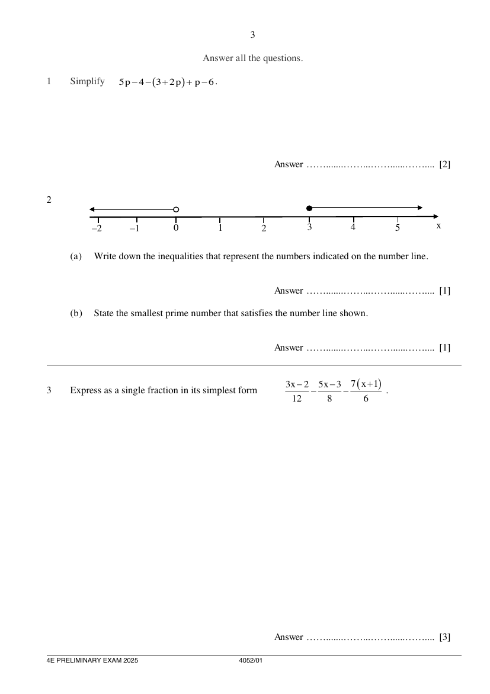

## Question

> **Marks:** (a) 1, (b) 1; total 2
> **Page:** 3

**(a)** Write down the inequalities that represent the numbers indicated on the number line. [1]

**(b)** State the smallest prime number that satisfies the number line shown. [1]

## Answer Scheme

**(a)** Write down the inequalities that represent the numbers indicated on the number line.

$$
x<0 \quad \text{or} \quad x\geq 3
$$

> **Marker's Comments:** Poorly done

**(b)** State the smallest prime number that satisfies the number line shown.

$$
3
$$
