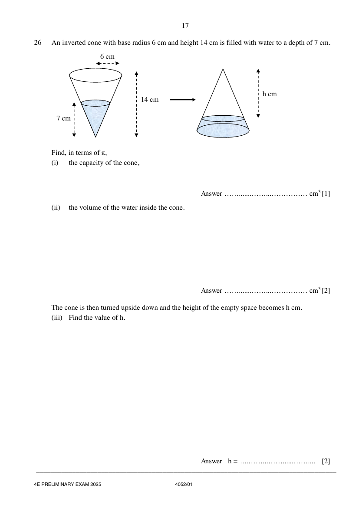

## Question

> **Marks:** (i) 1, (ii) 2, (iii) 2; total 5
> **Page:** 17

An inverted cone with base radius $6\text{ cm}$ and height $14\text{ cm}$ is filled with water to a depth of $7\text{ cm}$.

Find, in terms of $\pi$,

**(i)** the capacity of the cone, [1]

**(ii)** the volume of the water inside the cone. [2]

The cone is then turned upside down and the height of the empty space becomes $h\text{ cm}$.

**(iii)** Find the value of $h$. [2]

## Answer Scheme

**(i)** the capacity of the cone,

$$
V=\frac{1}{3}\pi(6)^{2}(14)=168\pi
$$

> **Marker's Comments:** Generally ok. Some students did not leave answers in terms of $\pi$

**(ii)** the volume of the water inside the cone.

Using similar triangles,

$$
\frac{r}{6}=\frac{7}{14}
$$

$$
r=3
$$

$$
V=\frac{1}{3}\pi(3)^{2}(7)=21\pi
$$

> **Marker's Comments:** Some students who did not use similar triangles to get radius is $3\text{ cm}$.

**(iii)** Find the value of $h$.

Using similar figures,

$$
\left(\frac{h}{14}\right)^{3}=\frac{168\pi-21\pi}{168\pi}
$$

$$
\frac{h^{3}}{14^{3}}=\frac{147}{168}
$$

$$
h=13.4\ (3\text{ s.f.})
$$

> **Marker's Comments:** Poorly done. Students did not see that they can use similar figures to get the volume. Some tried to get the values for radius or height but applied the wrong concept of using height of $7\text{ cm}$ and $14\text{ cm}$ as the ratio of similar heights.
