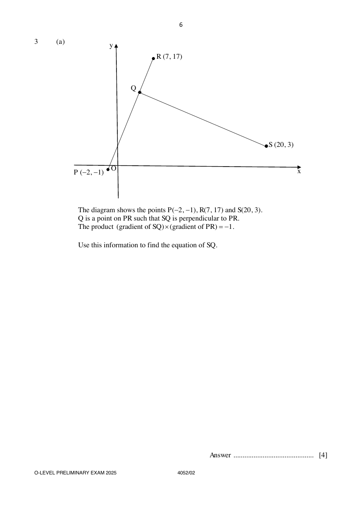

## Question

> **Marks:** (a) 4, (b) 3, (c) 2; total 9
> **Page:** 6–7

**(a)** The diagram shows the points $P(-2,-1)$, $R(7,17)$ and $S(20,3)$.
$Q$ is a point on $PR$ such that $SQ$ is perpendicular to $PR$.
The product $(\text{gradient of }SQ)\times(\text{gradient of }PR)=-1$.

Use this information to find the equation of $SQ$. [4]

**(b)** $G$ is the point $(5,3)$.
$H$ is the point $(-4,h)$, where $h>0$.
The length of line $GH$ is 15 units.

Find the value of $h$. [3]

**(c)** The $y$-intercept of the line $2x+ky-6=0$ is $-2$.

Find the value of $k$. [2]

## Answer Scheme

**(a)** Find the equation of $SQ$.

$$
\text{Gradient of }PR=\frac{17-(-1)}{7-(-2)}=2
$$

$$
\text{Gradient of }SQ=-\frac{1}{2}
$$

$$
y=-\frac{1}{2}x+c
$$

Substitute $S(20,3)$:

$$
3=-\frac{1}{2}(20)+c
$$

$$
c=13
$$

$$
y=-\frac{1}{2}x+13
$$

Error carried forward (ecf) maximum of 2 marks.

**(b)** Find the value of $h$.

$$
[5-(-4)]^{2}+(3-h)^{2}=15^{2}
$$

$$
9^{2}+(3-h)^{2}=225
$$

$$
(3-h)^{2}=144
$$

$$
3-h=12\quad\text{or}\quad 3-h=-12
$$

$$
h=-9\quad\text{or}\quad h=15
$$

Since $h>0$, $h=15$.

> **Marker's Comments:** $81+(h-3)^{2}\neq 9+(h-3)$. For example, $\sqrt{81+25}=10.3$ is correct. $\sqrt{81+25}=\sqrt{9}+\sqrt{5}=14=3.74$ is incorrect.

**(c)** Find the value of $k$.

$$
y=-\frac{2}{k}x+\frac{6}{k}
$$

$$
\frac{6}{k}=-2
$$

$$
k=-3
$$

> **Marker's Comments:** Many wrote $2x+ky-6=-2$. '$-2$' is the $y$-intercept, so you should substitute $(0,-2)$ into the original equation $2x+ky-6=0$.
