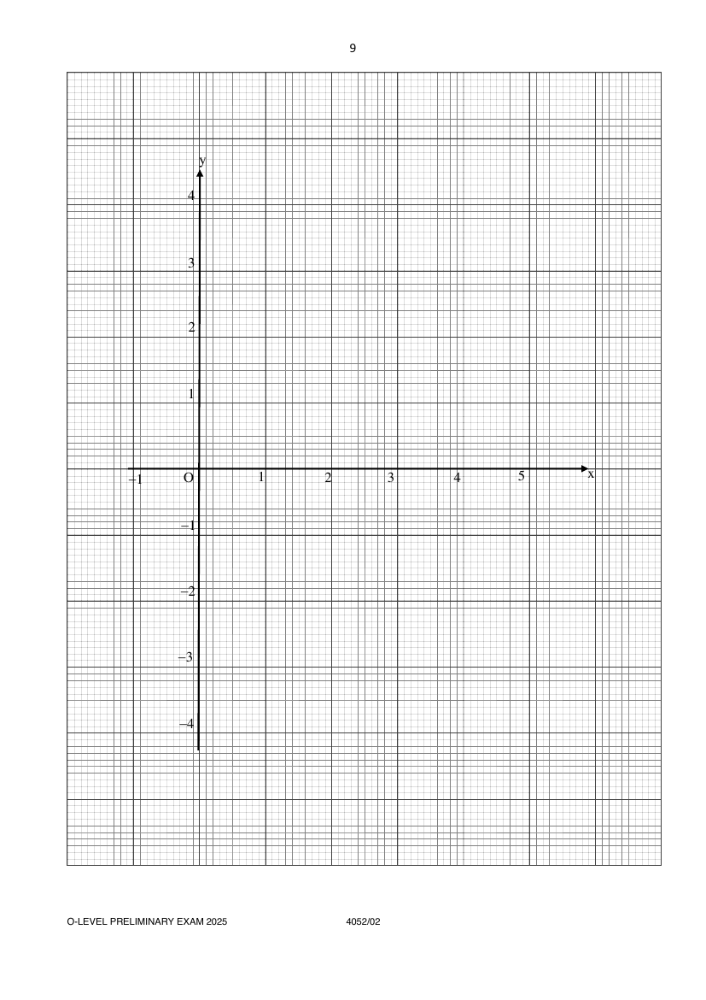

## Question

> **Marks:** (a) 1, (b) 3, (c) 2, (d)(i) 2, (d)(ii) 1, (d)(iii) 3; total 12
> **Page:** 8–9

**(a)** Complete the table of values for

$$
y=\frac{x}{4}\left(8-6x+x^{2}\right).
$$

Give your answer correct to 2 decimal places. [1]

| $x$ | $-1$ | $0$ | $0.5$ | $1$ | $1.5$ | $2$ | $2.5$ | $3$ | $4$ | $5$ |
| --- | --- | --- | --- | --- | --- | --- | --- | --- | --- | --- |
| $y$ | $-3.75$ | $0$ |  | $0.75$ | $0.47$ | $0$ | $-0.47$ | $-0.75$ | $0$ | $3.75$ |

**(b)** On the grid opposite, draw the graph of $y=\dfrac{x}{4}\left(8-6x+x^{2}\right)$ for $-1\leq x\leq 5$. [3]

**(c)** Use your graph to find the solution to the equation $x^{3}-6x^{2}+8x=12$ for $-1\leq x\leq 5$. [2]

**(d) (i)** Line $L$ has gradient $-0.5$ and passes through the point $(3,1)$.

Draw line $L$ on the same axes for $-1\leq x\leq 5$. [2]

**(ii)** Write down the $x$-coordinate of the point where line $L$ intersects the curve. [1]

**(iii)** This value of $x$ is the solution of the equation $x^{3}+Ax^{2}+Bx+C=0$.

Find the value of $A$, $B$ and $C$. [3]

## Answer Scheme

**(a)** Complete the table. The missing value is $0.66$.

> **Marker's Comments:** Quite a few did not follow 2 d.p. required.

**(b)** Draw the graph of $y=\dfrac{x}{4}\left(8-6x+x^{2}\right)$ for $-1\leq x\leq 5$.

P2 — points plotted correctly. C1 — smooth curve.

> **Marker's Comments:** Some curves were not even S-shaped. A cubic graph is S-shaped. Usually a result of one or two points incorrectly plotted. Do not extend your graph beyond the first and last points in the table. It is a curve. No part should be linear/straight-line. Many curves were not smooth; some parts had "double lines". Some were using pencils not sharpened or not dark enough. Some lost marks as curve did not go through the middle of the plotted X.

**(c)** Use your graph to find the solution to $x^{3}-6x^{2}+8x=12$.

$$
x(x^{2}-6x+8)=12
$$

$$
\frac{x}{4}(8-6x+x^{2})=3
$$

Draw the line $y=3$.

From the graph, $x=4.9\pm 0.1$.

> **Marker's Comments:** Poorly done.

**(d) (i)** Line $L$ has gradient $-0.5$ and passes through $(3,1)$.

$$
y=-\frac{1}{2}x+c
$$

$$
1=-\frac{1}{2}(3)+c
$$

$$
c=\frac{5}{2}
$$

$$
y=-\frac{1}{2}x+\frac{5}{2}
$$

B1 for equation. B1 for drawing line. Or B2 for drawing line.

**(d) (ii)** Write down the $x$-coordinate of the point where line $L$ intersects the curve.

From the graph, $x=4.2\pm 0.1$.

> **Marker's Comments:** Poorly done. Some wrote unreadable answers. You can only read to the accuracy of half the smallest box.

**(d) (iii)** Find $A$, $B$ and $C$.

$$
\frac{x}{4}(8-6x+x^{2})=-\frac{1}{2}x+\frac{5}{2}
$$

$$
x(8-6x+x^{2})=-2x+10
$$

$$
x^{3}-6x^{2}+10x-10=0
$$

$$
A=-6,\quad B=10,\quad C=-10
$$

A2 for 3 answers.

> **Marker's Comments:** Poorly done.
