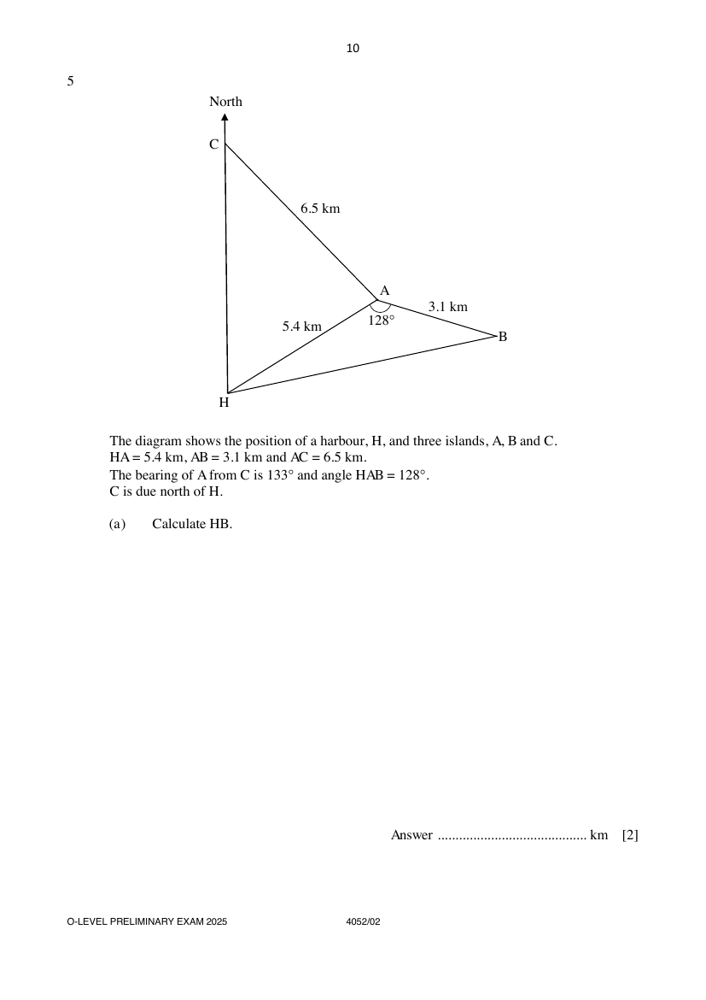

## Question

> **Marks:** (a) 2, (b) 3, (c) 2, (d) 3; total 10
> **Page:** 10–11

The diagram shows the position of a harbour, $H$, and three islands, $A$, $B$ and $C$.
$HA=5.4\text{ km}$, $AB=3.1\text{ km}$ and $AC=6.5\text{ km}$.
The bearing of $A$ from $C$ is $133^{\circ}$ and angle $HAB=128^{\circ}$.
$C$ is due north of $H$.

**(a)** Calculate $HB$. [2]

**(b)** Show that angle $CAH=71.3^{\circ}$, correct to one decimal place. [3]

**(c)** Find the bearing of $B$ from $A$. [2]

**(d)** A vertical tower is located on island $A$.
The angle of elevation of the top of the tower from $B$ is $14^{\circ}$.

Calculate the angle of elevation of the top of the tower from $C$. [3]

## Answer Scheme

**(a)** Calculate $HB$.

$$
HB^{2}=5.4^{2}+3.1^{2}-2(5.4)(3.1)\cos 128^{\circ}
$$

$$
HB=\sqrt{59.382346}=7.705994
$$

$$
HB=7.71\text{ km (to 3 s.f.)}
$$

**(b)** Show that angle $CAH=71.3^{\circ}$.

$$
\angle HCA=180^{\circ}-133^{\circ}=47^{\circ}
$$

$$
\frac{5.4}{\sin 47^{\circ}}=\frac{6.5}{\sin\angle CHA}
$$

$$
\sin\angle CHA=\frac{6.5\sin 47^{\circ}}{5.4}
$$

$$
\angle CHA=61.68256^{\circ}
$$

$$
\angle CAH=133^{\circ}-61.68256^{\circ}=71.31744^{\circ}
$$

$$
\angle CAH=71.3^{\circ}\text{ (to 1 d.p.) (shown)}
$$

> **Marker's Comments:** When question asks for a number to "show", you need to show the unrounded number before the rounded number that you are aiming to get.

**(c)** Find the bearing of $B$ from $A$.

Draw North line at $A$.

$$
\angle NAH=180^{\circ}-61.7^{\circ}=118.3^{\circ}\ (\text{int }\angle s)
$$

$$
\text{Bearing of }B\text{ from }A=360^{\circ}-128^{\circ}-118.3^{\circ}=113.7^{\circ}
$$

> **Marker's Comments:** Poor presentation in finding bearings. Many still rounded to 3 s.f.

**(d)** Calculate the angle of elevation of the top of the tower from $C$.

$$
\tan 14^{\circ}=\frac{h}{3.1}
$$

$$
h=0.772917\text{ km}
$$

$$
\tan\theta=\frac{0.772917}{6.5}
$$

$$
\theta=6.8^{\circ}\text{ (to 1 d.p.)}
$$

Angle of elevation $=6.8^{\circ}$.

> **Marker's Comments:** A few students have ecf mark(s) here.
