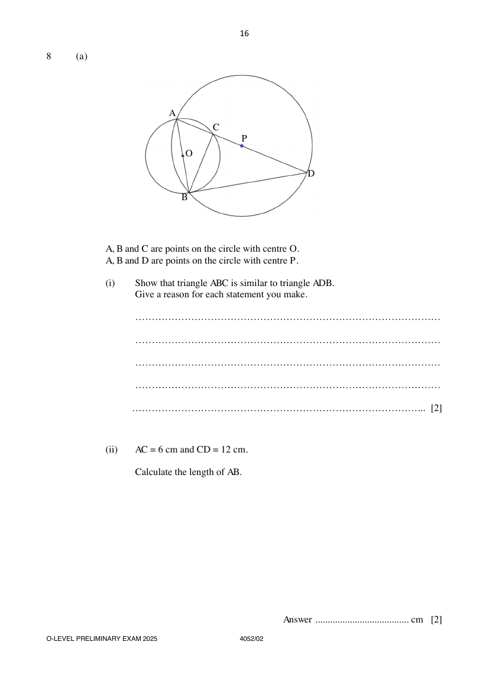
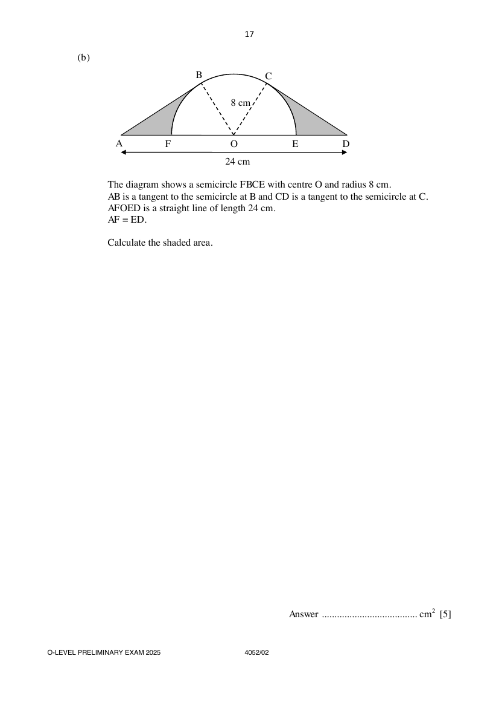

## Question

> **Marks:** (a)(i) 2, (a)(ii) 2, (b) 5; total 9
> **Page:** 16–17

**(a)** $A$, $B$ and $C$ are points on the circle with centre $O$.
$A$, $B$ and $D$ are points on the circle with centre $P$.

**(i)** Show that triangle $ABC$ is similar to triangle $ADB$.
Give a reason for each statement you make. [2]

**(ii)** $AC=6\text{ cm}$ and $CD=12\text{ cm}$.

Calculate the length of $AB$. [2]

**(b)** The diagram shows a semicircle $FBCE$ with centre $O$ and radius $8\text{ cm}$.
$AB$ is a tangent to the semicircle at $B$ and $CD$ is a tangent to the semicircle at $C$.
$AFOED$ is a straight line of length $24\text{ cm}$.
$AF=ED$.

Calculate the shaded area. [5]

## Answer Scheme

**(a) (i)** Show that triangle $ABC$ is similar to triangle $ADB$.

$$
\angle BAC=\angle DAB\ (\text{common})
$$

$$
\angle ACB=90^{\circ}\ (\text{angle in semicircle})
$$

$$
\angle ABD=90^{\circ}\ (\text{angle in semicircle})
$$

$$
\angle ACB=\angle ABD
$$

Triangle $ABC$ is similar to triangle $ADB$ (AA Similarity Test).

A1 only if both proofs are given.

> **Marker's Comments:** Poorly done. Instead of proving 2 pairs of equal angles, answers such as $AB$ is common were seen. Some proved 1 pair of equal angles only and concluded that the 2 triangles were similar.

**(a) (ii)** Calculate the length of $AB$.

$$
\frac{AB}{AC}=\frac{AD}{AB}
$$

$$
\frac{AB}{6}=\frac{18}{AB}
$$

$$
AB^{2}=108
$$

$$
AB=10.4\text{ cm (to 3 s.f.)}
$$

> **Marker's Comments:** Poorly done. Didn't apply ratio of sides to find $AB$. Some correctly used Pythagoras' Theorem. Diameter, $AD=18\text{ cm}$. Radius, $PB=9\text{ cm}$, $CP=3\text{ cm}$. Found $CB$ and $AB$.

**(b)** Calculate the shaded area.

$$
OD=12\text{ cm}
$$

$$
\angle OCD=90^{\circ}\ (\text{tangent perpendicular to radius})
$$

$$
\cos\angle COD=\frac{8}{12}
$$

$$
\angle COD=0.841069\text{ rad}
$$

$$
\text{Area of sector }COE=\frac{1}{2}(8)^{2}(0.841069)=26.9142\text{ cm}^{2}
$$

$$
\text{Area of }\triangle COD=\frac{1}{2}(8)(12)\sin 0.841069=35.7771\text{ cm}^{2}
$$

$$
\text{Shaded area}=2\times(35.7771-26.9142)=17.7\text{ cm}^{2}\text{ (to 3 s.f.)}
$$

> **Marker's Comments:** Some wrongly assumed $\angle AOB=\angle BOC=\angle COD=60^{\circ}$. Some wrongly calculated area of $\triangle COD=\dfrac{1}{2}(8)(12)$. Many left this question blank.
