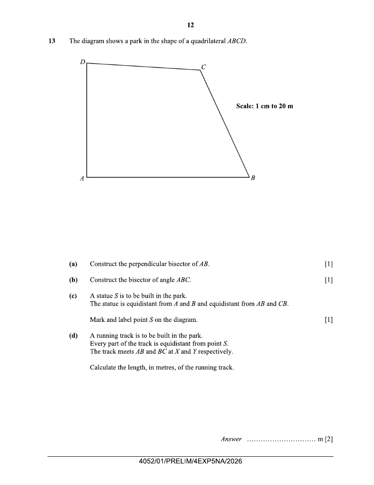
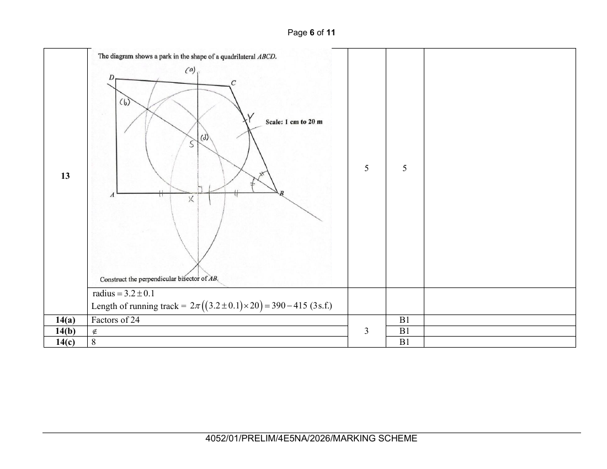

## Question

> **Marks:** (a) 1, (b) 1, (c) 1, (d) 2; total 5
> **Page:** 12

The diagram shows a park in the shape of a quadrilateral $ABCD$.

Scale: 1 cm to 20 m

**(a)** Construct the perpendicular bisector of $AB$. [1]

**(b)** Construct the bisector of angle $ABC$. [1]

**(c)** A statue $S$ is to be built in the park.
The statue is equidistant from $A$ and $B$ and equidistant from $AB$ and $CB$.

Mark and label point $S$ on the diagram. [1]

**(d)** A running track is to be built in the park.
Every part of the track is equidistant from point $S$.
The track meets $AB$ and $BC$ at $X$ and $Y$ respectively.

Calculate the length, in metres, of the running track. [2]

## Answer Scheme

radius $=3.2\pm 0.1$

Length of running track $=2\pi((3.2\pm 0.1)\times 20)=390-415$ (3 s.f.)

The scheme awards 5 marks for the construction and the length together.
