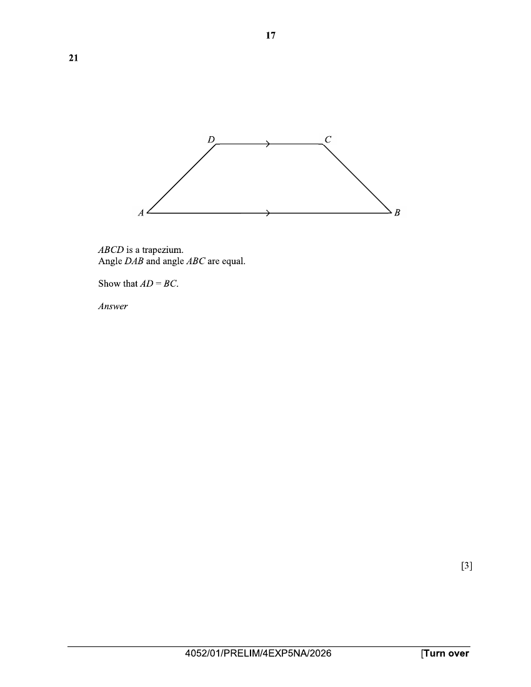

## Question

> **Marks:** 3
> **Page:** 17

$ABCD$ is a trapezium.
Angle $DAB$ and angle $ABC$ are equal.

Show that $AD=BC$. [3]

## Answer Scheme

$\angle EDC=\angle DAB$ (corr. $\angle$s, $AB//DC$)

$\angle ECD=\angle CBA$ (corr. $\angle$s, $AB//DC$)

$\therefore \triangle EDC$ is an isosceles triangle.

Hence $EA=EB$ ($\triangle EAB$ is an isosceles triangle)

$EA-ED=EB-EC$ ($\triangle EDC$ is an isosceles triangle)

$AD=BC$

[M1, M1, A1]

Alternatively, M1 for any of the correct A, A, S:

$\angle DAE=\angle CBF$ (given)

$\angle AED=\angle CFB=90^{\circ}$

$DE=CF$ (height of trapezium)

$\therefore \triangle ADE\equiv\triangle BCF$ (AAS)

$\therefore AD=BC$

[M2, A1]

Alternatively:

$$
\sin\angle DAE=\frac{h}{AD},\quad \sin\angle CBF=\frac{h}{BC}
$$

Since $\angle DAE=\angle CBF$, $\dfrac{h}{AD}=\dfrac{h}{BC}$, so $AD=BC$.

[M1, M1, A1]
