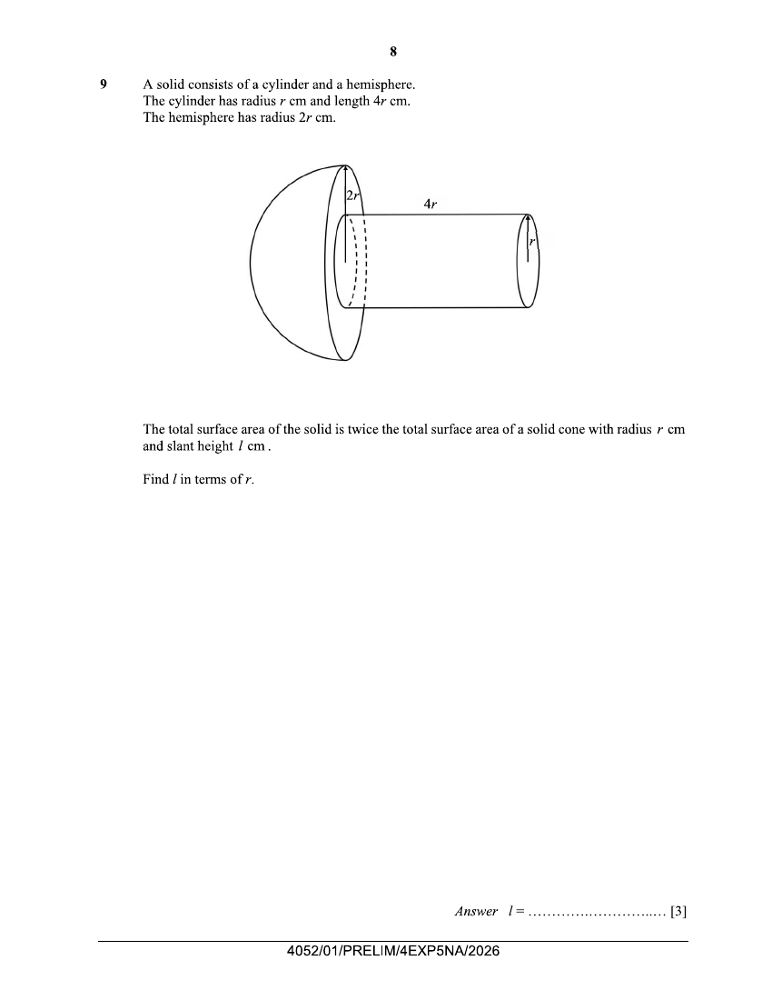

## Question

> **Marks:** 3
> **Page:** 8

A solid consists of a cylinder and a hemisphere.
The cylinder has radius $r$ cm and length $4r$ cm.
The hemisphere has radius $2r$ cm.

The total surface area of the solid is twice the total surface area of a solid cone with radius $r$ cm and slant height $l$ cm.

Find $l$ in terms of $r$. [3]

## Answer Scheme

$$
\begin{aligned}
\text{S.A. of solid}&=2\pi(2r)^{2}+\pi(2r)^{2}-\pi r^{2}+2\pi r(4r)+\pi r^{2}\\
&=20\pi r^{2}
\end{aligned}
$$

$$
20\pi r^{2}=2(\pi r^{2}+\pi rl)
$$

$l=9r$

[M1, M1 their S.A., A1]
