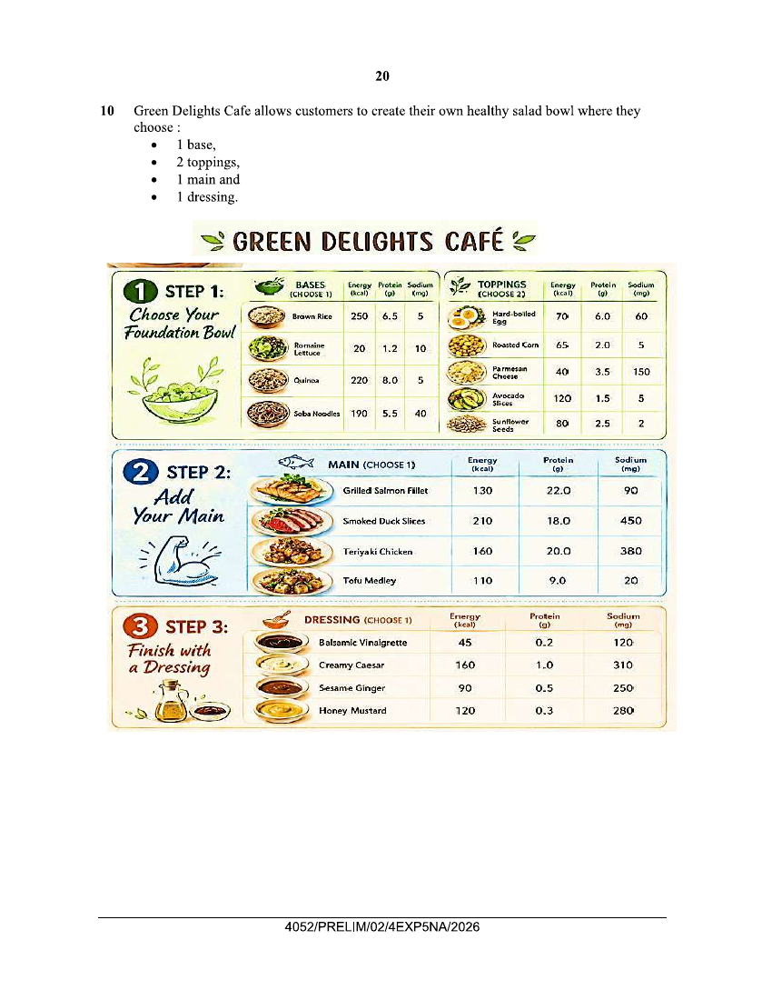
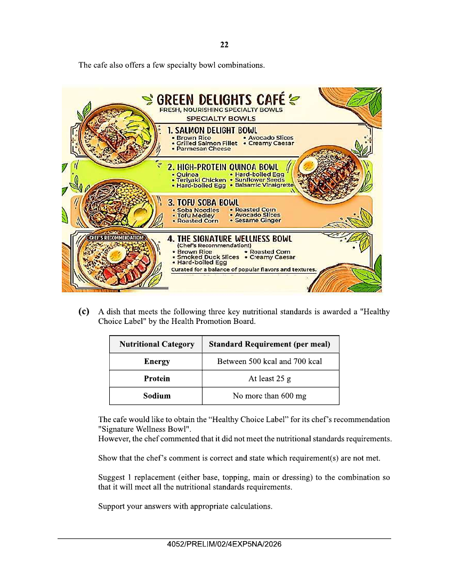

## Question

> **Marks:** (a)(i) 1, (a)(ii) 1, (b) 2, (c) 6; total 10
> **Page:** 20–23

Green Delights Cafe allows customers to create their own healthy salad bowl where they choose:

- 1 base,
- 2 toppings,
- 1 main and
- 1 dressing.

Values read from the menu. A figure that is hard to read is marked.

| Item | Energy (kcal) | Protein (g) | Sodium (mg) |
| --- | --- | --- | --- |
| Brown Rice | 250 | 6.5 | 5 |
| Romaine Lettuce | 20 | 1.2 | 10 |
| Quinoa | 220 | 8.0 | 5 |
| Soba Noodles | 190 | 5.5 | 40 |
| Hard-boiled Egg | 70 | 6.0 | 60 |
| Roasted Corn | 65 | 2.0 | 5 |
| Parmesan Cheese | 40 | 3.5 | 150 |
| Avocado Slices | 120 | 1.5 | 5 |
| Sunflower Seeds | 80 | 2.5 | 2 |
| Grilled Salmon Fillet | 130 | 22.0 | 90 |
| Smoked Duck Slices | 210 | 18.0 | 450 |
| Teriyaki Chicken | 160 | 20.0 | 380 |
| Tofu Medley | 110 | 9.0 | 20 |
| Balsamic Vinaigrette | 45 | 0.2 | 120 |
| Creamy Caesar | 160 | 1.0 | 310 |
| Sesame Ginger | 90 | 0.5 | 250 |
| Honey Mustard | 120 | 0.3 | 280 |

**(a)** Karen selected romaine lettuce, parmesan cheese, sunflower seeds, smoked duck slices with creamy caesar dressing for her own salad bowl combination.

**(i)** Calculate the total protein content in Karen's choice of salad bowl. [1]

**(ii)** Calculate the amount of energy (in kcal) Karen will gain from her choice of salad bowl. [1]

**(b)** Propose the ingredients to select for a healthy salad bowl that offers the lowest amount of sodium content possible. [2]

The cafe also offers a few specialty bowl combinations.

**(c)** A dish that meets the following three key nutritional standards is awarded a "Healthy Choice Label" by the Health Promotion Board.

| Nutritional Category | Standard Requirement (per meal) |
| --- | --- |
| Energy | Between 500 kcal and 700 kcal |
| Protein | At least 25 g |
| Sodium | No more than 600 mg |

The cafe would like to obtain the "Healthy Choice Label" for its chef's recommendation "Signature Wellness Bowl".
However, the chef commented that it did not meet the nutritional standards requirements.

Show that the chef's comment is correct and state which requirement(s) are not met.

Suggest 1 replacement (either base, topping, main or dressing) to the combination so that it will meet all the nutritional standards requirements.

Support your answers with appropriate calculations. [6]

Answer space for Question 10c is on the following page of the paper.

## Answer Scheme

**(a) (i)** Total protein content

$$
=1.2+3.5+18+2.5+1.0=26.2\text{ g}
$$

[B1]

**(ii)** Amount of energy

$$
=20+40+80+210+160=510\text{ kcal}
$$

[B1]

The scheme prints kCal.

**(b)** B1 for base and toppings. B1 for main and dressing.

Base: Brown Rice or Quinoa

Toppings: Sunflower seeds and (Roasted Corn or Avocado Slices)

Main: Tofu Medley

Dressing: Balsamic Vinagrette

[B2]

**(c)** B1 for each correct total calculated for energy, protein and sodium.

| Ingredients of Signature Wellness Bowl | Energy | Protein | Sodium |
| --- | --- | --- | --- |
| Brown Rice | 250 | 6.5 | 5 |
| Smoked Duck | 210 | 18 | 450 |
| Hard-Boiled Egg | 70 | 6 | 60 |
| Roasted Corn | 65 | 2.0 | 5 |
| Creamy Caesar | 160 | 1.0 | 310 |
| Total | 755 | 33.5 | 830 |

[M3]

The Chef's comment is correct as the total energy gained is $755$ kCal and the sodium content $830$ mg have exceeded the standard requirements of between $500$ kCal and $700$ kCal amount of energy and less than $600$ mg of sodium. [A1]

Must indicate the 2 nutritional standards that are not met.

| Ingredients | Energy | Protein | Sodium |
| --- | --- | --- | --- |
| Brown Rice | 250 | 6.5 | 5 |
| Grilled Salmon Fillet | 130 | 22 | 90 |
| Hard-Boiled Egg | 70 | 6 | 60 |
| Roasted Corn | 65 | 2.0 | 5 |
| Creamy Caesar | 160 | 1.0 | 310 |
| Total | 675 kcal | 37.5 | 470 mg |

[M1 correct calculation of all 3 nutritional categories]

Replace the main smoked duck slices with grilled salmon fillet. The amount of energy gained is reduced to $675$ kCal and the amount of sodium content is also reduced to $470$ mg and keeping the amount of protein above $25$ g. [A1]
