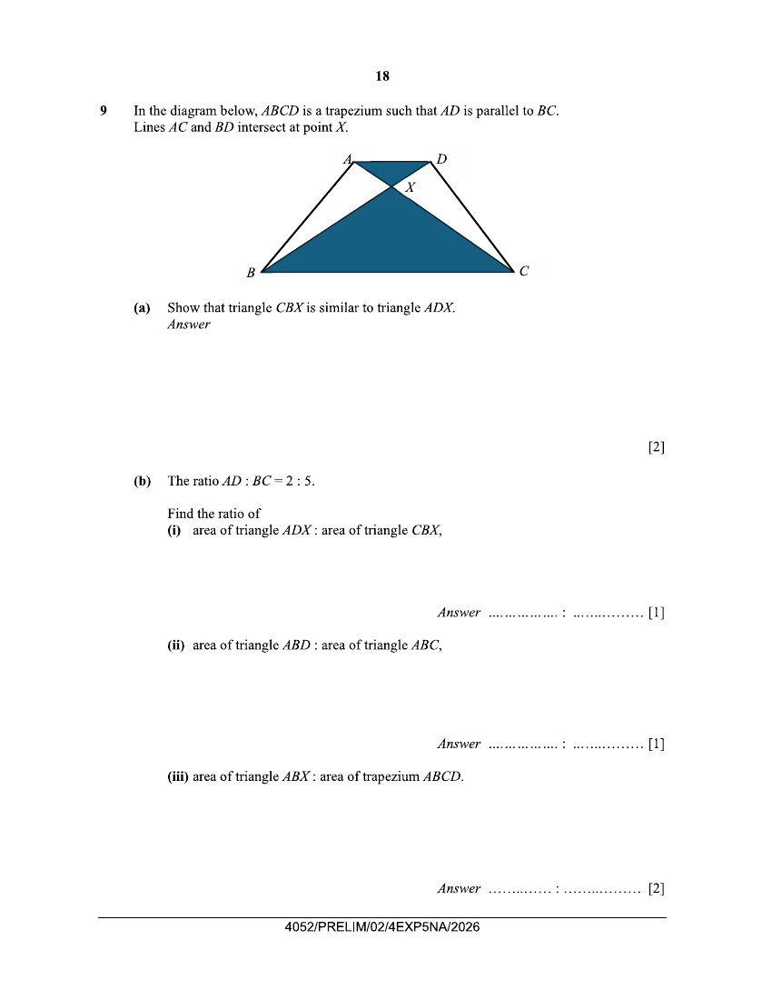

## Question

> **Marks:** (a) 2, (b)(i) 1, (b)(ii) 1, (b)(iii) 2, (c) 2, (d) 2; total 10
> **Page:** 18–19

In the diagram below, $ABCD$ is a trapezium such that $AD$ is parallel to $BC$.
Lines $AC$ and $BD$ intersect at point $X$.

**(a)** Show that triangle $CBX$ is similar to triangle $ADX$. [2]

**(b)** The ratio $AD:BC=2:5$.

Find the ratio of

**(i)** area of triangle $ADX$ : area of triangle $CBX$, [1]

**(ii)** area of triangle $ABD$ : area of triangle $ABC$, [1]

**(iii)** area of triangle $ABX$ : area of trapezium $ABCD$. [2]

**(c)** Given that the area of triangle $ABX$ is $8\text{ cm}^{2}$, find the area of the shaded region. [2]

**(d)** State an additional condition for triangle $BAX$ and triangle $CDX$ to be congruent.
Support your answer with reasons. [2]

## Answer Scheme

**(a)** B1 for each pair of corresponding angles indicated with reason.

$\angle ADX=\angle CBX$ (alt. $\angle$, $AD//BC$)

$\angle AXD=\angle CXB$ (vert. opp. $\angle$s)

$\triangle CBX$ is similar to $\triangle ADX$ (AA similarity test)

[B2]

**(b) (i)** Area of $\triangle DAX$ : area of $\triangle BCX$ $=4:25$ [B1]

**(ii)** Note that $\triangle ABD$ and $\triangle ABC$ are triangles of the same height.

Area of $\triangle ABD$ : area of $\triangle ABC$ $=AD:BC=2:5$ [B1]

**(iii)**

$$
\begin{aligned}
\text{Area of }\triangle ABD:\text{area of }\triangle ABC
&=\text{area of }(\triangle ABX+\triangle DAX):\text{area of }(\triangle ABX+\triangle BCX)\\
&=4+p:25+p
\end{aligned}
$$

$$
\frac{4+p}{25+p}=\frac{2}{5}
$$

$$
20+5p=50+2p,\quad 3p=30,\quad p=10
$$

Area of triangle $ABX$ : area of trapezium $ABCD$

$$
=10:(10+10+4+25)=10:49
$$

[M1, A1]

**(c)** $10$ units represent $8\text{ cm}^{2}$

$$
\text{Area of shaded region}=\frac{8}{10}\times(4+25)=23.2\text{ cm}^{2}
$$

[M1, A1]

**(d)** $AB=DC$ is the additional condition. [B1]

Then $AX=DX$ and $BX=CX$. Therefore triangle $BAX$ and triangle $CDX$ will be congruent (SSS). [B1]

Alternatively the condition can be $AX=DX$ or $BX=CX$. State based on the condition. The condition set will make trapezium $ABCD$ an isosceles trapezium.
