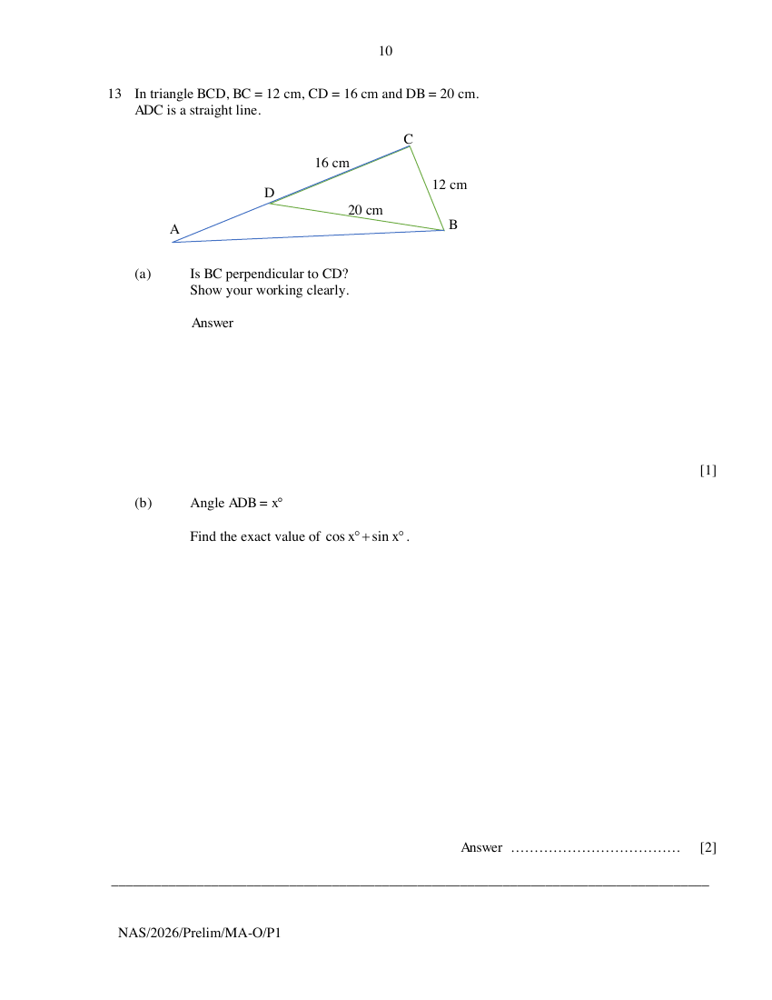

## Question

> **Marks:** (a) 1, (b) 2; total 3
> **Page:** 10

In triangle $BCD$, $BC = 12\text{ cm}$, $CD = 16\text{ cm}$ and $DB = 20\text{ cm}$.
$ADC$ is a straight line.

**(a)** Is $BC$ perpendicular to $CD$?
Show your working clearly. [1]

**(b)** Angle $ADB = x^{\circ}$

Find the exact value of $\cos x^{\circ}+\sin x^{\circ}$. [2]

## Answer Scheme

**(a)**

$$
\begin{aligned}
BD^{2} &= 20^{2}=400 \\
BC^{2}+CD^{2} &= 12^{2}+16^{2}=400
\end{aligned}
$$

Since $BD^{2}=BC^{2}+CD^{2}$, by Converse of Pythagoras' Theorem, it is a right angled triangle where $BD$ is the hypotenuse. Hence $BC$ is perpendicular to $CD$.

(must be 2 separate lines) B1.

OR

$$
\cos\angle BCD=\frac{12^{2}+16^{2}-20^{2}}{2(12)(16)}
$$

Angle $BCD=90^{\circ}$. Hence $BC$ is perpendicular to $CD$. B1.

**(b)**

$$
\begin{aligned}
\cos x+\sin x &= -\cos\angle CDB+\sin\angle CDB \\
&= -\frac{16}{20}+\frac{12}{20} \\
&= -\frac{1}{5}
\end{aligned}
$$

M1: either value. A1.
