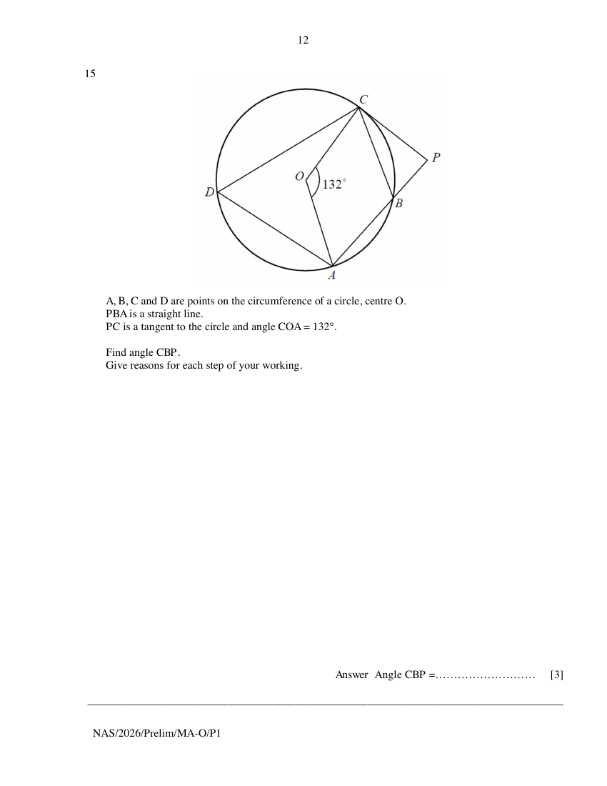

## Question

> **Marks:** 3
> **Page:** 12

$A$, $B$, $C$ and $D$ are points on the circumference of a circle, centre $O$.
$PBA$ is a straight line.
$PC$ is a tangent to the circle and angle $COA = 132^{\circ}$.

Find angle $CBP$.
Give reasons for each step of your working. [3]

## Answer Scheme

Angle $CDA=132^{\circ}\div 2=66^{\circ}$ (angle at centre $= 2$ angles at circumference). B1 with reason.

Angle $CBA=180^{\circ}-66^{\circ}=114^{\circ}$ (angles in opposite segment). B1 with reason.

Angle $CBP=180^{\circ}-114^{\circ}=66^{\circ}$ (adjacent angles on a straight line). B1: value of $66^{\circ}$.
