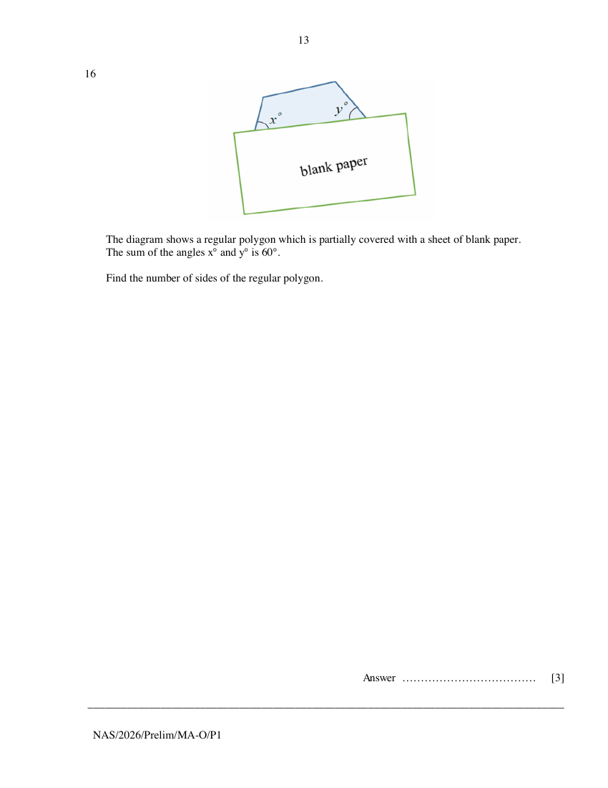

## Question

> **Marks:** 3
> **Page:** 13

The diagram shows a regular polygon which is partially covered with a sheet of blank paper.
The sum of the angles $x^{\circ}$ and $y^{\circ}$ is $60^{\circ}$.

Find the number of sides of the regular polygon. [3]

## Answer Scheme

Size of interior angle: $(360^{\circ}-60^{\circ})\div 2=150^{\circ}$. M1: interior angle.

Size of exterior angle: $180^{\circ}-150^{\circ}=30^{\circ}$. M1: exterior angle.

Number of sides: $360^{\circ}\div 30^{\circ}=12$ sides. A1.
