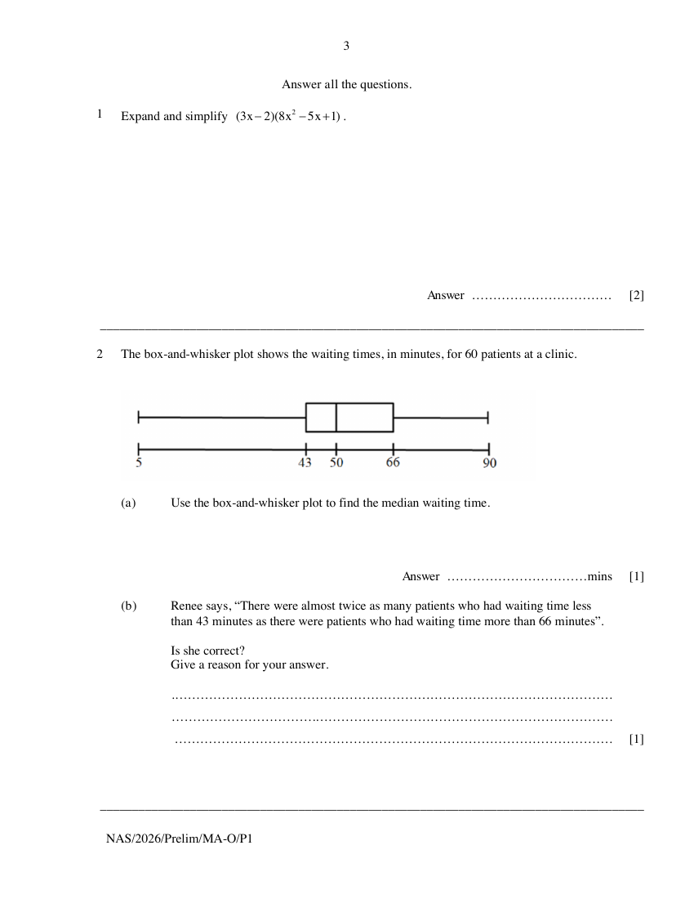

## Question

> **Marks:** (a) 1, (b) 1; total 2
> **Page:** 3

The box-and-whisker plot shows the waiting times, in minutes, for 60 patients at a clinic.

**(a)** Use the box-and-whisker plot to find the median waiting time. [1]

**(b)** Renee says, "There were almost twice as many patients who had waiting time less than 43 minutes as there were patients who had waiting time more than 66 minutes".

Is she correct?
Give a reason for your answer. [1]

## Answer Scheme

**(a)** 50 mins. B1.

**(b)** She is incorrect as the number of patients who have waiting time less than 43 minutes is the same/equal as the number of patients who have waiting time more than 66 minutes. B1.
