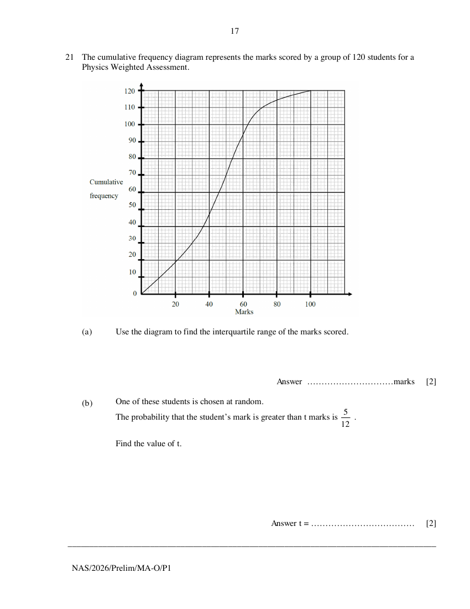

## Question

> **Marks:** (a) 2, (b) 2; total 4
> **Page:** 17

The cumulative frequency diagram represents the marks scored by a group of 120 students for a Physics Weighted Assessment.

**(a)** Use the diagram to find the interquartile range of the marks scored. [2]

**(b)** One of these students is chosen at random.
The probability that the student's mark is greater than $t$ marks is $\dfrac{5}{12}$.

Find the value of $t$. [2]

## Answer Scheme

**(a)** $58-30=28$. M1: either value. A1.

**(b)** $\dfrac{7}{12}\times 120=70$. Score: 50. B1: 70. B1 [Allow B2].

> **Markers Report:** Well done. Some makes the mistake of read off from 50 instead.
