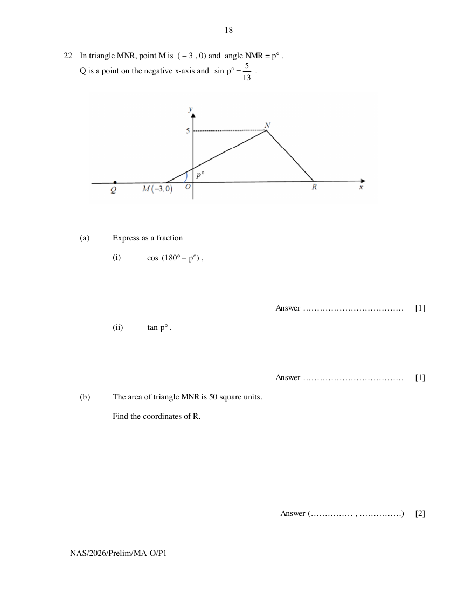

## Question

> **Marks:** (a)(i) 1, (a)(ii) 1, (b) 2; total 4
> **Page:** 18

In triangle $MNR$, point $M$ is $(-3, 0)$ and angle $NMR = p^{\circ}$.
$Q$ is a point on the negative $x$-axis and $\sin p^{\circ}=\dfrac{5}{13}$.

**(a)** Express as a fraction

**(i)** $\cos(180^{\circ}-p^{\circ})$, [1]

**(ii)** $\tan p^{\circ}$. [1]

**(b)** The area of triangle $MNR$ is 50 square units.

Find the coordinates of $R$. [2]

## Answer Scheme

**(a) (i)** $-\dfrac{12}{13}$. B1.

**(a) (ii)** $\dfrac{5}{12}$. B1.

**(b)**

$$
\frac{1}{2}(5)(b)=50
$$

$b=20$.

$20-3=17$.

$R(17, 0)$.

M1 [Shoelace will not be given if there is any error]. A1.
