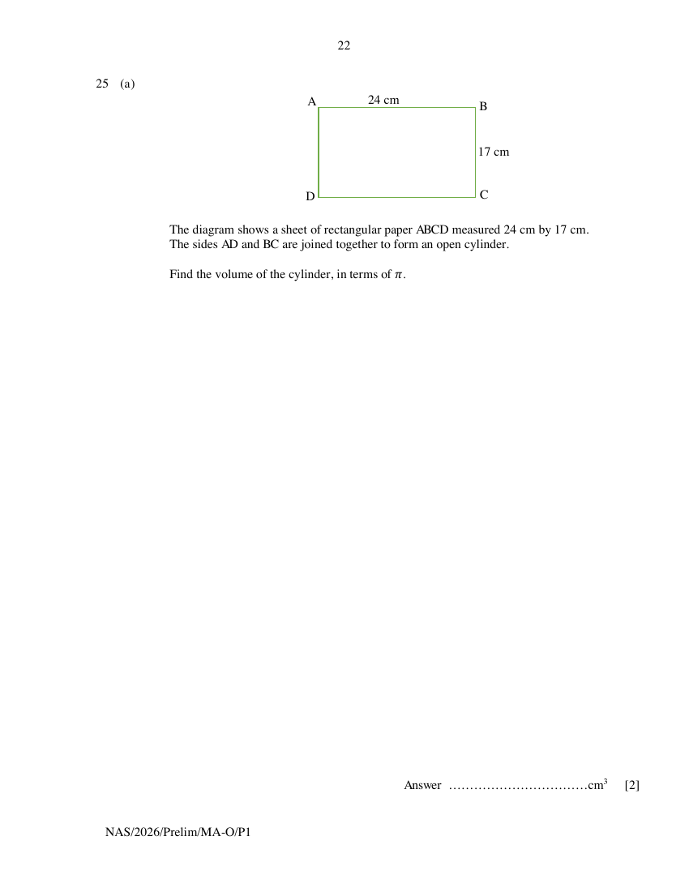
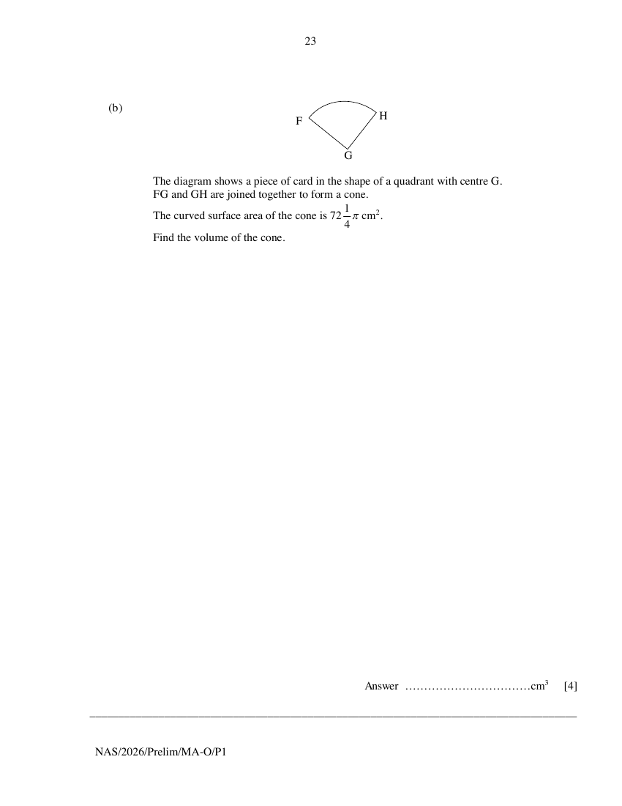

## Question

> **Marks:** (a) 2, (b) 4; total 6
> **Page:** 22–23

**(a)**

The diagram shows a sheet of rectangular paper $ABCD$ measured 24 cm by 17 cm.
The sides $AD$ and $BC$ are joined together to form an open cylinder.

Find the volume of the cylinder, in terms of $\pi$. [2]

**(b)**

The diagram shows a piece of card in the shape of a quadrant with centre $G$.
$FG$ and $GH$ are joined together to form a cone.
The curved surface area of the cone is $72\dfrac{1}{4}\pi\text{ cm}^{2}$.
Find the volume of the cone. [4]

## Answer Scheme

**(a)** Let $r$ be the radius of the cylinder.

$$
\begin{aligned}
24 &= 2\pi r \\
r &= \frac{12}{\pi} \\
\text{Volume} &= \pi\left(\frac{12}{\pi}\right)^{2}(17)=\frac{2448}{\pi}\text{ cm}^{3}
\end{aligned}
$$

M1: length $=$ circumference. A1.

> **Markers Report:** Not well done. Some assumed 17 cm to be the circumference, and others did not understand what it meant by leaving your answer in pi.

**(b)** Let the radius of circle be $l$ and radius of the cone be $r$.

Arc length $FH$: $\dfrac{1}{4}(2\pi l)$

$$
\begin{aligned}
\frac{1}{4}(2\pi l) &= 2\pi r \\
r &= \frac{1}{4}l
\end{aligned}
$$

M1: arc length $=$ circumference.

Curved surface area:

$$
\pi\left(\frac{1}{4}l\right)l=72\frac{1}{4}\pi
$$

$l=17$. M1: Find $l$ (Equate curved surface area to area of quadrant).

Volume of cone:

$$
\begin{aligned}
\frac{1}{3}\pi\left(\frac{1}{4}l\right)^{2}\sqrt{289-\frac{289}{16}} &= 311.34438\text{ cm}^{3} \\
&= 311\text{ cm}^{3}
\end{aligned}
$$

M1: height of cone. A1.

> **Markers Report:** Not well done. Many did not able to draw the relations that arc length of the quadrant would be the circumference of the cone and the curved surface area is the area of the quadrant. Others are not able to identify the slang height of the cone is the radius of the quadrant.
