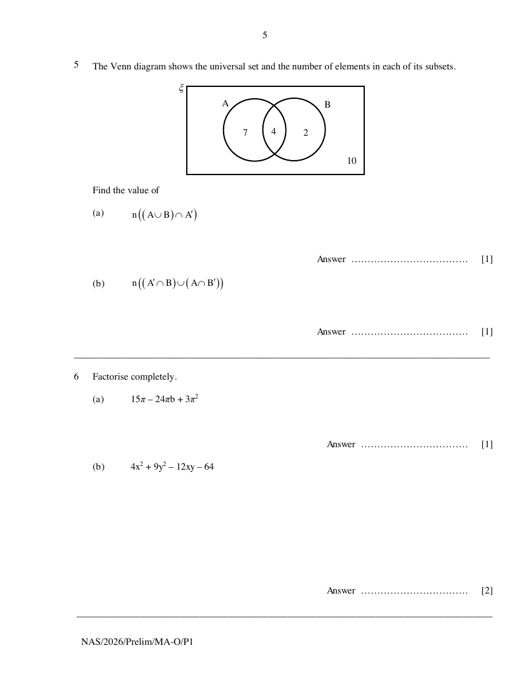

## Question

> **Marks:** (a) 1, (b) 1; total 2
> **Page:** 5

The Venn diagram shows the universal set and the number of elements in each of its subsets.

Find the value of

**(a)** $\mathrm{n}\left((A\cup B)\cap A'\right)$ [1]

**(b)** $\mathrm{n}\left((A'\cap B)\cup (A\cap B')\right)$ [1]

## Answer Scheme

**(a)** 2. B1.

**(b)** 9. B1.
