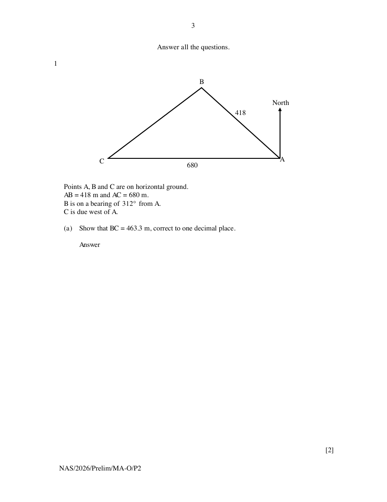
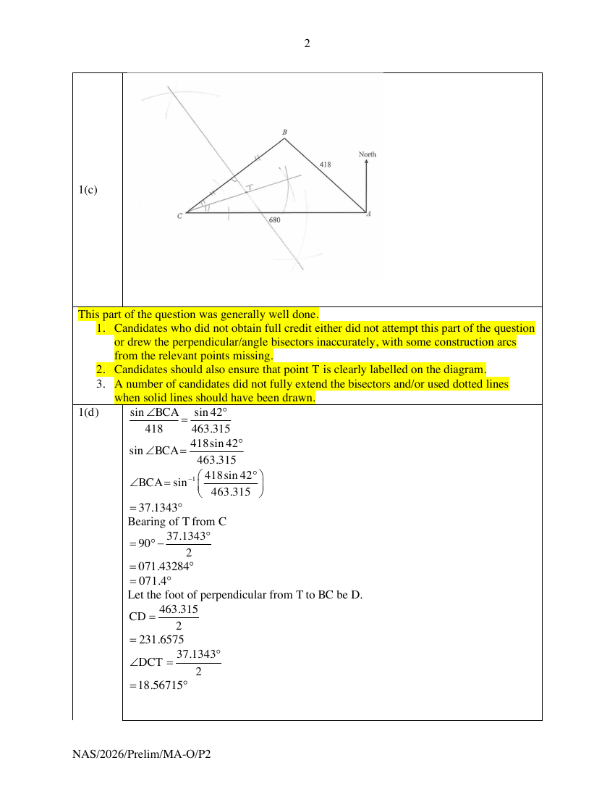

## Question

> **Marks:** (a) 2, (b) 2, (c) 3, (d) 5; total 12
> **Page:** 3–5

Points $A$, $B$ and $C$ are on horizontal ground.
$AB = 418\text{ m}$ and $AC = 680\text{ m}$.
$B$ is on a bearing of $312^{\circ}$ from $A$.
$C$ is due west of $A$.

**(a)** Show that $BC = 463.3\text{ m}$, correct to one decimal place. [2]

**(b)** A surveyor is standing at point $A$ and operates a drone hovering vertically above point $C$.
The surveyor's eye level is 1.74 m above the ground.
The angle of elevation of the drone from the surveyor's eye level is $16.5^{\circ}$.

Estimate the height of the drone above the ground at point $C$.
Give your answer to one decimal place. [2]

**(c)** The surveyor receives the following instructions.

Maintaining the same height above the ground, navigate the drone to a point $T$ within triangle $ABC$ such that $T$ is equidistant from points $B$ and $C$, and is also equidistant from the lines $AC$ and $BC$.

Using geometrical constructions, locate and label point $T$ on the diagram on the previous page. [3]

**(d)** The surveyor receives further clarification about the location of $T$.

$T$ is on a bearing of $x^{\circ}$ from $C$.
$CT = y\text{ m}$.

By calculation, find the values of $x$ and $y$.
Do not obtain your answers by measurement from the diagram. [5]

## Answer Scheme

**(a)**

$$
\begin{aligned}
\angle BAC &= 312^{\circ}-270^{\circ}=42^{\circ} \\
BC^{2} &= 418^{2}+680^{2}-2(418)(680)\cos 42^{\circ} \\
BC &= \sqrt{214661.0296} \\
&= 463.315 \\
&= 463.3\text{ m (to 1 d.p.)}
\end{aligned}
$$

> **Markers Report:** This part of the question was generally well done.
>
> 1. Candidates need to understand that, for a "show" question where the final answer is given to a required accuracy, they must show an intermediate answer to at least two more decimal places/significant figures, as appropriate, than the required accuracy. Quite a number of candidates did not do so.
> 2. Candidates need to know the importance of reading the question carefully and following the specified accuracy requirements.

**(b)** Let the drone be at point $S$.
Let the point above $C$ and at eye level of surveyor be point $E$.

$$
\begin{aligned}
\tan 16.5^{\circ} &= \frac{SE}{680} \\
SE &= 680\tan 16.5^{\circ} \\
&= 201.425\ldots \\
\text{Height of drone above }C &= 201.425+1.74 \\
&= 203.165 \\
&= 203.2\text{ m (1 d.p.)}
\end{aligned}
$$

> **Markers Report:** This part of the question was generally well done.
>
> 1. Candidates need to ensure that their presentation is clear (e.g. they should not use the letter O if it may be mistaken for the number 0).
> 2. Again, candidates should ensure that they read the question carefully, as it was specifically stated that the answer should be given to 1 decimal place.

**(c)** Locate and label $T$ by geometrical construction on the diagram: the perpendicular bisector of $BC$ and the angle bisector of angle $ACB$.

> **Markers Report:** This part of the question was generally well done.
>
> 1. Candidates who did not obtain full credit either did not attempt this part of the question or drew the perpendicular/angle bisectors inaccurately, with some construction arcs from the relevant points missing.
> 2. Candidates should also ensure that point $T$ is clearly labelled on the diagram.
> 3. A number of candidates did not fully extend the bisectors and/or used dotted lines when solid lines should have been drawn.

**(d)**

$$
\begin{aligned}
\frac{\sin\angle BCA}{418} &= \frac{\sin 42^{\circ}}{463.315} \\
\sin\angle BCA &= \frac{418\sin 42^{\circ}}{463.315} \\
\angle BCA &= \sin^{-1}\left(\frac{418\sin 42^{\circ}}{463.315}\right) \\
&= 37.1343^{\circ}
\end{aligned}
$$

Bearing of $T$ from $C$

$$
\begin{aligned}
&= 90^{\circ}-\frac{37.1343^{\circ}}{2} \\
&= 071.43284^{\circ} \\
&= 071.4^{\circ}
\end{aligned}
$$

Let the foot of perpendicular from $T$ to $BC$ be $D$.

$$
\begin{aligned}
CD &= \frac{463.315}{2}=231.6575 \\
\angle DCT &= \frac{37.1343^{\circ}}{2}=18.56715^{\circ} \\
\cos 18.56715^{\circ} &= \frac{231.6575}{CT} \\
CT &= 244.377 \\
&= 244\text{ m (3 s.f.)}
\end{aligned}
$$

$x=071.4$ and $y=244$.

> **Markers Report:** This part of the question was generally poorly done. Quite a number of candidates did not attempt this part of the question at all.
>
> 1. Among the candidates who attempted this part of the question, many did not realise that ($x$) represents a bearing. Hence, it should be expressed as a three-digit bearing and given to 1 decimal place.
> 2. Candidates should try to draw a diagram to help them visualise what is required by the question. The correct construction of perpendicular and angle bisectors would also help them solve this part of the question.
