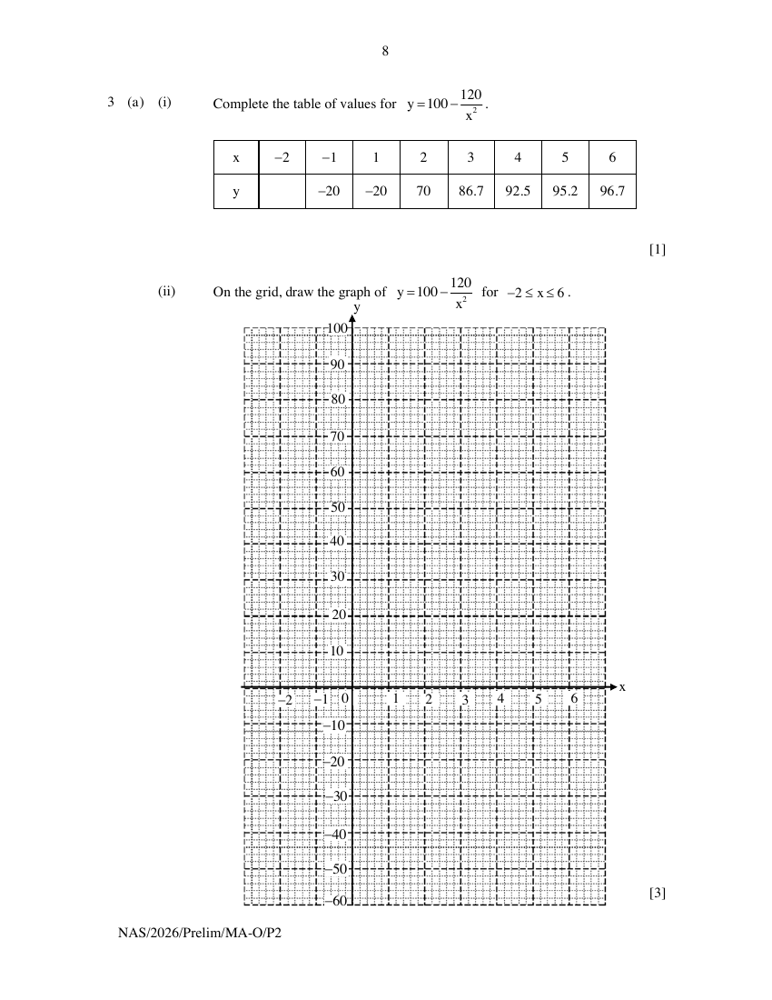

## Question

> **Marks:** (a)(i) 1, (a)(ii) 3, (a)(iii) 2, (b)(i) 1, (b)(ii) 4; total 11
> **Page:** 8–9

**(a) (i)** Complete the table of values for $y=100-\dfrac{120}{x^{2}}$.

| $x$ | $-2$ | $-1$ | $1$ | $2$ | $3$ | $4$ | $5$ | $6$ |
| --- | --- | --- | --- | --- | --- | --- | --- | --- |
| $y$ |  | $-20$ | $-20$ | $70$ | $86.7$ | $92.5$ | $95.2$ | $96.7$ |

[1]

**(ii)** On the grid, draw the graph of $y=100-\dfrac{120}{x^{2}}$ for $-2\leq x\leq 6$. [3]

**(iii)** By drawing a tangent, estimate the gradient of the curve at $x=3.5$. [2]

**(b)** Carl has two types of power banks, Power Bank A and Power Bank B, for charging his mobile phone.

**(i)** Using Power Bank A, the battery percentage, $y\%$, of Carl's mobile phone after $x$ hours of charging is given by the function $y=100-\dfrac{120}{x^{2}}$, $x\geq 2$.

What does your answer to part (a)(iii) tell you about Power Bank A? [1]

**(ii)** The solutions to the equation $x^{3}-5x^{2}+12=0$ represent the charging durations for which Power Bank A and Power Bank B charge Carl's phone to the same battery percentage.
Carl has only 4 hours to charge his mobile phone.

By drawing a suitable straight line on the grid, determine whether Carl should use Power Bank A or Power Bank B. [4]

## Answer Scheme

**(a) (i)** When $x=-2$, $y=70$.

> **Markers Report:** Okay.

**(a) (ii)** Graph of $y=100-\dfrac{120}{x^{2}}$ for $-2\leq x\leq 6$.

> **Markers Report:** Most students didn't realise that this is a graph of reciprocal function and joined the points $(-1,-20)$ to $(1,-20)$. Smooth curves generally obtained. Marks were given so long points are connected to get a "smooth" curve.

**(a) (iii)** Estimated gradient

$$
=\frac{98-72}{5-0.4}=5.65\text{ (3 s.f.)}
$$

> **Markers Report:** Line of tangent is mostly drawn at the correct point. Revised range for gradient: 4.8 to 6.67. Students are advised to draw tangent better. No gap between line and curve and avoid "overlapping" with the curve (like "multiple points of intersection" to avoid).

**(b) (i)** At/After 3.5 h of charging, Power Bank A's rate of charging is 5.65% per hour.

> **Markers Report:** Okay. Stronger students understand to make reference to (iii) and is able to conclude that it is the % per hour. Weaker students were not able to connect to (i) and give answers irrelevant to the question.

**(b) (ii)**

$$
\begin{aligned}
x^{3}-5x^{2}+12 &= 0 \\
x-5+\frac{12}{x^{2}} &= 0 \\
10x-50+\frac{120}{x^{2}} &= 0 \\
10x+50 &= 100-\frac{120}{x^{2}}
\end{aligned}
$$

Draw $y=10x+50$.

Since the battery percentage after 4 h is higher with Power Bank A ($92.5\%>90\%$), Carl should charge his phone using Power Bank A.

> **Markers Report:** Poorly done, students did not know how to approach the question. They end up solving the cubic equation to obtain values of $x$.
