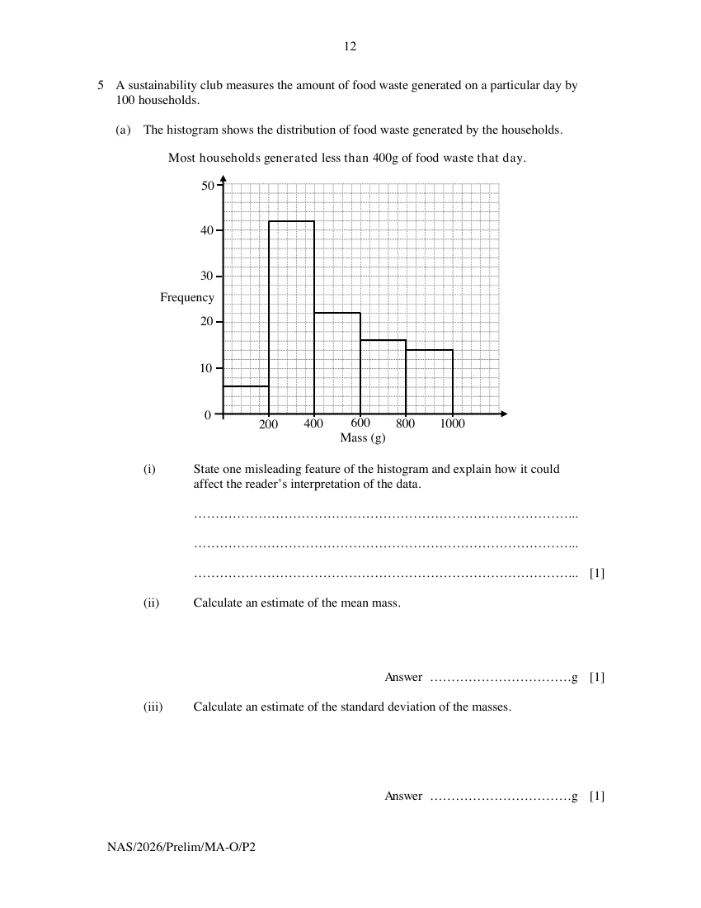

## Question

> **Marks:** (a)(i) 1, (a)(ii) 1, (a)(iii) 1, (a)(iv) 1, (b)(i) 2, (b)(ii) 2; total 8
> **Page:** 12–13

A sustainability club measures the amount of food waste generated on a particular day by 100 households.

**(a)** The histogram shows the distribution of food waste generated by the households.

**(i)** State one misleading feature of the histogram and explain how it could affect the reader's interpretation of the data. [1]

**(ii)** Calculate an estimate of the mean mass. [1]

**(iii)** Calculate an estimate of the standard deviation of the masses. [1]

**(iv)** The club forgot to include the food waste generated by one household.
The household generated 420 g of food waste that day.
The club updates the histogram to include this household and recalculates the estimated mean using the grouped data.
The club expects the estimated mean to decrease.

Without calculation, explain whether the club is correct. [1]

**(b)** The club also surveys 80 households from two residential blocks, Block A and Block B.
Each household is classified according to the main type of food waste it threw away.
The frequency table summarises the data collected.

|  | Block A | Block B |
| --- | --- | --- |
| Cooked Food | 22 | 29 |
| Uncooked Scraps | 17 | 12 |

**(i)** Two households in Block A are chosen at random.

Find the probability that both households threw away cooked food. [2]

**(ii)** Three households that threw away uncooked scraps are chosen at random.

Find the probability that exactly one of the households is from Block B. [2]

## Answer Scheme

**(a) (i)** The title is misleading because it interprets the data for the reader and is biased. In fact, less than 50% of the households (48%) generated less than 400 g of food waste that day.

> **Markers Report:** Only stronger students understands to state the feature (title), with some of them using headings. A number did not identify the feature and explained based on their understanding of the description from the title.

**(a) (ii)** 480 g.

> **Markers Report:** It was surprising that students forgot that the mid-value of each class interval to be used to calculate mean, they used the upper limits instead.

**(a) (iii)** 234 g (3 s.f.).

**(a) (iv)** In calculating the new estimated mean, the amount of food waste contributed by the additional household, 420 g, will be estimated to be 500 g $> 480$ g. The new estimated mean will be higher than the original one, thus the club is incorrect.

> **Markers Report:** Not many students connects the value of 420 g to be placed in the class interval (400 – 600) and the estimated value to be used is 500 g.

**(b) (i)**

$$
\frac{22}{39}\times\frac{21}{38}=\frac{77}{247}
$$

> **Markers Report:** Generally okay. Students who got this wrong probably did not read question carefully and use the wrong total. Some misunderstood and multiply the probability by 2.

**(b) (ii)**

$$
3\left(\frac{12}{29}\times\frac{17}{28}\times\frac{16}{27}\right)=\frac{272}{609}
$$

> **Markers Report:** Similarly to (b)(i), students did not use the correct total in calculation of the required probability.
