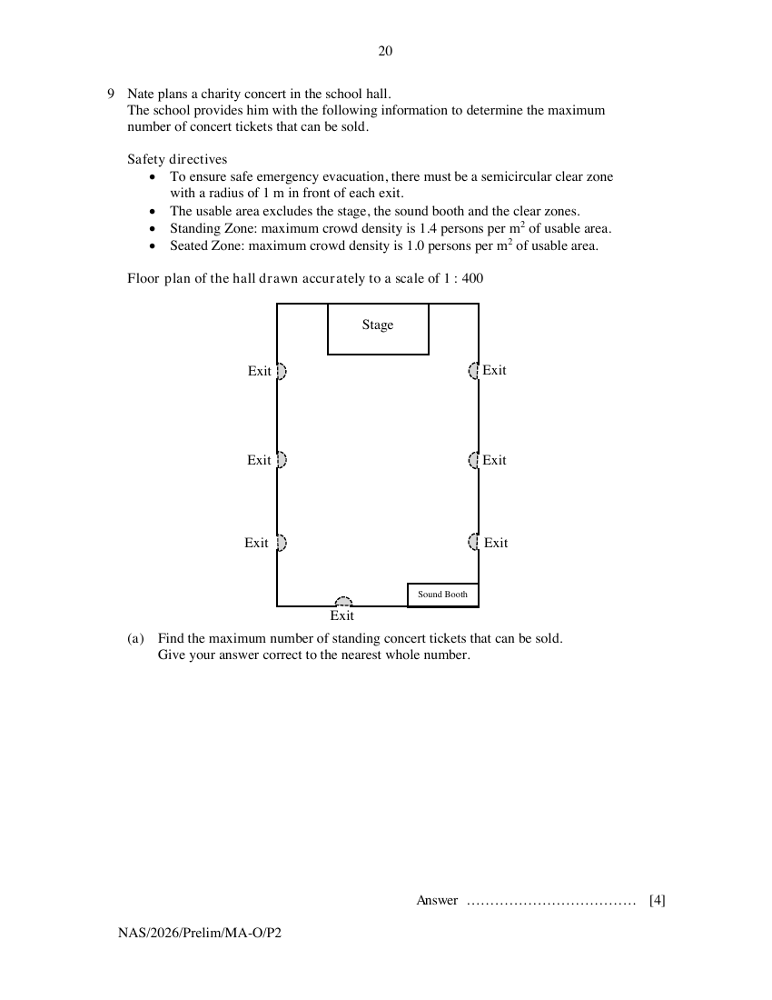

## Question

> **Marks:** (a) 4, (b) 7; total 11
> **Page:** 20–21

Nate plans a charity concert in the school hall.
The school provides him with the following information to determine the maximum number of concert tickets that can be sold.

Safety directives

- To ensure safe emergency evacuation, there must be a semicircular clear zone with a radius of 1 m in front of each exit.
- The usable area excludes the stage, the sound booth and the clear zones.
- Standing Zone: maximum crowd density is 1.4 persons per m$^{2}$ of usable area.
- Seated Zone: maximum crowd density is 1.0 persons per m$^{2}$ of usable area.

Floor plan of the hall drawn accurately to a scale of $1:400$

**(a)** Find the maximum number of standing concert tickets that can be sold.
Give your answer correct to the nearest whole number. [4]

Nate considers two ticketing options and their associated logistical costs.

Ticketing Option 1: Pure Standing Setup

- Standing tickets: &#36;18 per ticket

Ticketing Option 2: Hybrid Setup (Seated + Standing)

- The usable area is divided into three distinct zones: the Seated Zone that is nearest the stage, followed by the Safety Zone, then the Standing Zone.
- The Safety Zone is a horizontal strip, 1.2 m wide, separating the Seated Zone from the Standing Zone.
- After excluding the Safety Zone, the remaining usable area is divided in the ratio $3:2$ between the Seated Zone and the Standing Zone respectively.
- Seated tickets: &#36;32 per ticket
- Standing ticket: &#36;15 per ticket

Logistical Costs

- Fixed setup cost: The logistics team charges a fixed fee of &#36;1500 for Option 1. This fee is 20% higher for Option 2 due to the additional logistics required for chair installation.
- Transaction fee: A fee of &#36;1.50 is charged by the online ticketing vendor for every ticket sold.

**(b)** Determine the option that Nate should select.
Justify the decision you make and show your calculations clearly. [7]

---

**END OF PAPER**

## Answer Scheme

**(a)**

$$
\begin{aligned}
\text{Area of hall} &= (9\times 4)\times(6\times 4)=864\text{ m}^{2} \\
\text{Area of stage} &= (1.5\times 4)\times(3\times 4)=72\text{ m}^{2} \\
\text{Area of sound booth} &= (0.7\times 4)\times(2.1\times 4)=23.52\text{ m}^{2} \\
\text{Area of clear zones} &= \pi(1)^{2}\times 3.5=10.99557\text{ m}^{2} \\
\text{Total usable area} &= 864-72-23.52-10.99557=757.48443\text{ m}^{2} \\
\text{Maximum number of standing tickets} &= 757.48443\times 1.4 \\
&= 1060.478 \\
&= 1060\text{ (nearest whole number)}
\end{aligned}
$$

**(b)** Option 1:

$$
\begin{aligned}
\text{Revenue} &= 1060\times 18=&#36;19080 \\
\text{Cost} &= 1500+1060\times 1.5=&#36;3090 \\
\text{Profit} &= 19080-3090=&#36;15990
\end{aligned}
$$

Option 2:

$$
\begin{aligned}
\text{Usable area excluding safety zone} &= 757.48443-1.2\times(6\times 4) \\
&= 728.68443\text{ m}^{2} \\
\text{Usable area for Seated Zone} &= \frac{3}{5}\times 728.68443=437.21\text{ m}^{2} \\
\text{Maximum number of seated tickets} &= 437.21\times 1=437\text{ (nearest whole number)} \\
\text{Usable area for Standing Zone} &= \frac{2}{5}\times 728.68443=291.47\text{ m}^{2} \\
\text{Maximum number of standing tickets} &= 291.47\times 1.4=408.058 \\
&= 408\text{ (nearest whole number)} \\
\text{Revenue} &= 437\times 32+408\times 15=&#36;20104 \\
\text{Cost} &= 1.2\times 1500+(437+408)\times 1.5=&#36;3067.50 \\
\text{Profit} &= 20104-3067.50=&#36;17036.50
\end{aligned}
$$

Since $&#36;17036.50>&#36;15990$, Nate should select Option 2 to maximise profit and raise more funds for charity.

> **Markers Report:** For students who attempted Q9, they generally scored well. Method marks were awarded as long as attempts were taken to calculate the actual area and revenue/cost. Students who annotated and showed working clearly generally scored better, as it helped marker to award method marks.
>
> 9(a):
>
> 1. Common challenge for students were in terms of managing the differences in units (cm vs m; cm$^{2}$ vs m$^{2}$).
> 2. Some students divided the usable area by the "density", i.e. by 1.4 persons per m$^{2}$, instead of multiplying it by 1.4. For students who made this mistake, you may want to consider using units to help decide whether you should divide or multiply.
>
> 9(b):
>
> 1. Most students knew that Nate should decide by considering the profit of the respective options. A few students did not know so, and did not differentiate revenue and cost.
> 2. Amongst students who attempted, a few students did not know how to calculate the usable area for Option 2.
