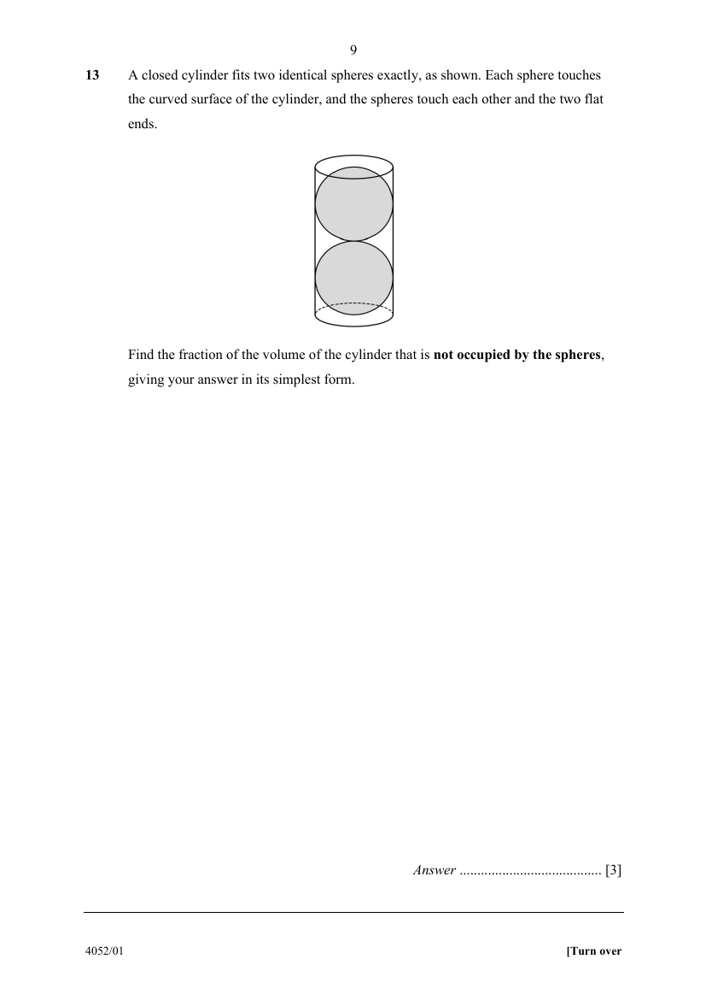

## Question

> **Marks:** 3
> **Page:** 9

A closed cylinder fits two identical spheres exactly, as shown. Each sphere touches the curved surface of the cylinder, and the spheres touch each other and the two flat ends.

Find the fraction of the volume of the cylinder that is **not** occupied by the spheres, giving your answer in its simplest form. [3]

## Answer Scheme

Let the sphere radius be $r$. Then cylinder radius $=r$ and height $=4r$.

$$
\text{Cylinder}=\pi r^{2}(4r)=4\pi r^{3}
$$

$$
\text{Two spheres}=2\times\frac{4}{3}\pi r^{3}=\frac{8}{3}\pi r^{3}
$$

$$
\text{Fraction empty}=\frac{4\pi r^{3}-\frac{8}{3}\pi r^{3}}{4\pi r^{3}}=\frac{1}{3}
$$
