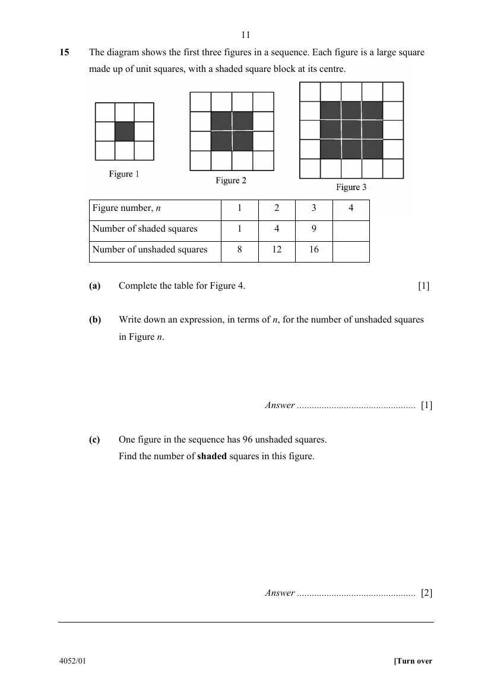

## Question

> **Marks:** (a) 1, (b) 1, (c) 2; total 4
> **Page:** 11

The diagram shows the first three figures in a sequence. Each figure is a large square made up of unit squares, with a shaded square block at its centre.

| Figure number, $n$ | $1$ | $2$ | $3$ | $4$ |
| --- | --- | --- | --- | --- |
| Number of shaded squares | $1$ | $4$ | $9$ |  |
| Number of unshaded squares | $8$ | $12$ | $16$ |  |

**(a)** Complete the table for Figure $4$. [1]

**(b)** Write down an expression, in terms of $n$, for the number of unshaded squares in Figure $n$. [1]

**(c)** One figure in the sequence has $96$ unshaded squares.
Find the number of **shaded** squares in this figure. [2]

## Answer Scheme

**(a)** Figure $4$: shaded $=16$, unshaded $=20$.

**(b)** Unshaded in Figure $n=(n+2)^{2}-n^{2}=4n+4$.

**(c)**

$$
4n+4=96
$$

$$
n=23
$$

$$
\text{Shaded}=23^{2}=529
$$
