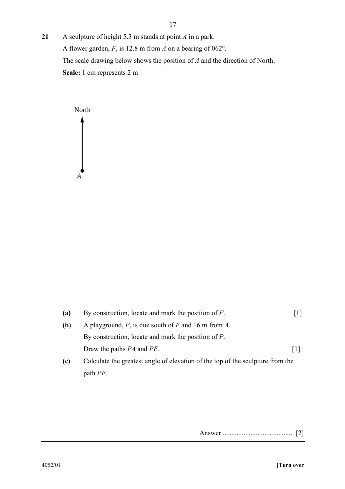

## Question

> **Marks:** (a) 1, (b) 1, (c) 2; total 4
> **Page:** 17

A sculpture of height $5.3\text{ m}$ stands at point $A$ in a park.
A flower garden, $F$, is $12.8\text{ m}$ from $A$ on a bearing of $062^{\circ}$.
The scale drawing below shows the position of $A$ and the direction of North.
Scale: $1\text{ cm}$ represents $2\text{ m}$

**(a)** By construction, locate and mark the position of $F$. [1]

**(b)** A playground, $P$, is due south of $F$ and $16\text{ m}$ from $A$.
By construction, locate and mark the position of $P$.
Draw the paths $PA$ and $PF$. [1]

**(c)** Calculate the greatest angle of elevation of the top of the sculpture from the path $PF$. [2]

## Answer Scheme

**(a)** From $A$, measure a bearing of $062^{\circ}$ and mark $F$ at $6.4\text{ cm}$ ($12.8\text{ m}$).

**(b)** $P$ is due south of $F$ with $AP=8\text{ cm}$ ($16\text{ m}$). Mark $P$ and draw $PA$, $PF$.

**(c)** $PF$ runs due north–south, so the shortest distance from $A$ to $PF$ is the easterly distance:

$$
d=12.8\sin 62^{\circ}=11.30\text{ m}
$$

$$
\text{Greatest angle}=\tan^{-1}\frac{5.3}{11.30}=25.1^{\circ}
$$
