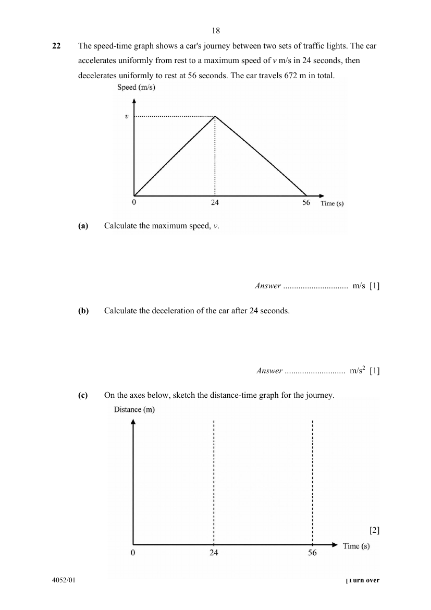

## Question

> **Marks:** (a) 1, (b) 1, (c) 2; total 4
> **Page:** 18

The speed-time graph shows a car's journey between two sets of traffic lights. The car accelerates uniformly from rest to a maximum speed of $v\text{ m/s}$ in $24$ seconds, then decelerates uniformly to rest at $56$ seconds. The car travels $672\text{ m}$ in total.

**(a)** Calculate the maximum speed, $v$. [1]

**(b)** Calculate the deceleration of the car after $24$ seconds. [1]

**(c)** On the axes below, sketch the distance-time graph for the journey. [2]

## Answer Scheme

**(a)**

$$
\frac{1}{2}(56)(v)=672
$$

$$
v=24\text{ m/s}
$$

**(b)**

$$
\text{Deceleration}=\frac{24}{56-24}=0.75\text{ m/s}^{2}
$$

**(c)** $0$ to $24\text{ s}$: curve from $(0,0)$, increasing gradient (concave up), reaching $288\text{ m}$.
$24$ to $56\text{ s}$: curve continues up with decreasing gradient (concave down), reaching $672\text{ m}$ at $56\text{ s}$.
