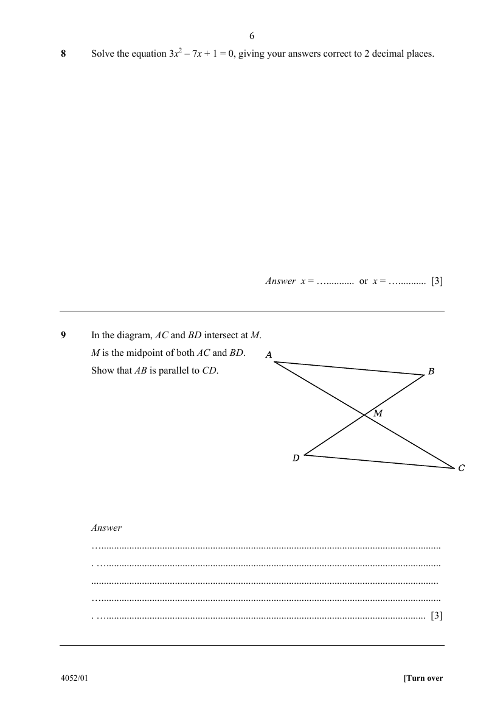

## Question

> **Marks:** 3
> **Page:** 6

In the diagram, $AC$ and $BD$ intersect at $M$.
$M$ is the midpoint of both $AC$ and $BD$.
Show that $AB$ is parallel to $CD$. [3]

## Answer Scheme

In $\triangle AMB$ and $\triangle CMD$:

$AM=CM$ ($M$ is the midpoint of $AC$)

$BM=DM$ ($M$ is the midpoint of $BD$)

$\angle AMB=\angle CMD$ (vertically opposite angles)

$\therefore \triangle AMB\equiv\triangle CMD$ (SAS)

$\therefore \angle BAM=\angle DCM$ (corresponding angles of congruent triangles)

These are equal alternate angles, so $AB\parallel CD$.
