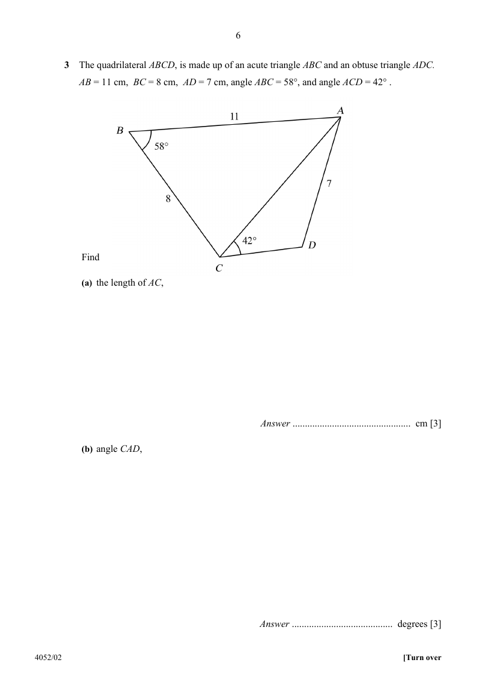

## Question

> **Marks:** (a) 3, (b) 3, (c) 2, (d) 2; total 10
> **Page:** 6–7

The quadrilateral $ABCD$, is made up of an acute triangle $ABC$ and an obtuse triangle $ADC$.
$AB=11\text{ cm}$, $BC=8\text{ cm}$, $AD=7\text{ cm}$, angle $ABC=58^{\circ}$, and angle $ACD=42^{\circ}$.

Find

**(a)** the length of $AC$, [3]

**(b)** angle $CAD$, [3]

**(c)** the length of $CD$, [2]

**(d)** the area of quadrilateral $ABCD$. [2]

## Answer Scheme

**(a)**

$$
AC^{2}=11^{2}+8^{2}-2(11)(8)\cos 58^{\circ}=185-176\cos 58^{\circ}=91.73
$$

$$
AC=9.58\text{ cm}
$$

**(b)**

$$
\frac{\sin\angle ADC}{9.578}=\frac{\sin 42^{\circ}}{7}
$$

$$
\sin\angle ADC=\frac{9.578\sin 42^{\circ}}{7}=0.9155
$$

$$
\angle ADC=113.7^{\circ}\text{ (obtuse)}
$$

$$
\angle CAD=180^{\circ}-42^{\circ}-113.7^{\circ}=24.3^{\circ}
$$

**(c)**

$$
\frac{CD}{\sin\angle CAD}=\frac{7}{\sin 42^{\circ}}
$$

$$
CD=\frac{7\sin 24.3^{\circ}}{\sin 42^{\circ}}=4.30\text{ cm}
$$

**(d)**

$$
\text{Area }ABC=\frac{1}{2}(11)(8)\sin 58^{\circ}=37.31
$$

$$
\text{Area }ACD=\frac{1}{2}(9.578)(7)\sin 24.3^{\circ}=13.79
$$

$$
\text{Area }ABCD=37.31+13.79=51.1\text{ cm}^{2}
$$
