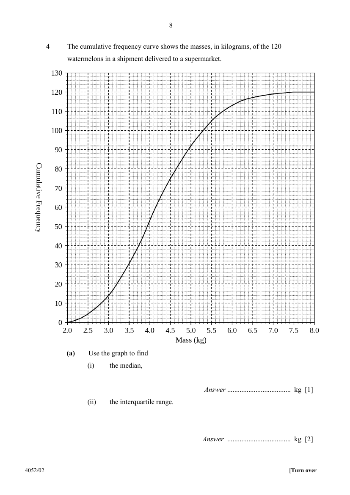
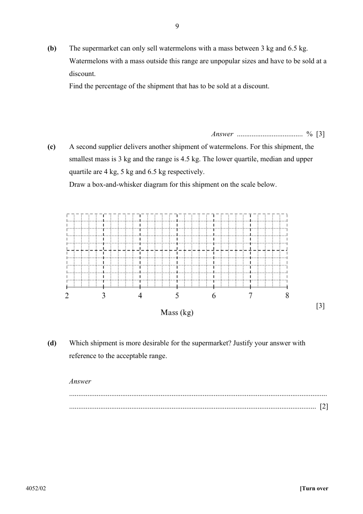

## Question

> **Marks:** (a)(i) 1, (a)(ii) 2, (b) 3, (c) 3, (d) 2; total 11
> **Page:** 8–9

The cumulative frequency curve shows the masses, in kilograms, of the $120$ watermelons in a shipment delivered to a supermarket.

**(a)** Use the graph to find

**(i)** the median, [1]

**(ii)** the interquartile range. [2]

**(b)** The supermarket can only sell watermelons with a mass between $3\text{ kg}$ and $6.5\text{ kg}$.
Watermelons with a mass outside this range are unpopular sizes and have to be sold at a discount.
Find the percentage of the shipment that has to be sold at a discount. [3]

**(c)** A second supplier delivers another shipment of watermelons. For this shipment, the smallest mass is $3\text{ kg}$ and the range is $4.5\text{ kg}$. The lower quartile, median and upper quartile are $4\text{ kg}$, $5\text{ kg}$ and $6.5\text{ kg}$ respectively.
Draw a box-and-whisker diagram for this shipment on the scale below. [3]

**(d)** Which shipment is more desirable for the supermarket? Justify your answer with reference to the acceptable range. [2]

## Answer Scheme

**(a)(i)** Median $\approx 4.1\text{ kg}$ (read at cumulative frequency $=60$)

**(a)(ii)** $Q_{1}=3.5\text{ kg}$ (CF $=30$), $Q_{3}=5.0\text{ kg}$ (CF $=90$)

$$
\text{IQR}=Q_{3}-Q_{1}=5.0-3.5=1.5\text{ kg}
$$

**(b)** Below $3\text{ kg}$: CF at $3.0\text{ kg}\approx 13$

Above $6.5\text{ kg}$: $120-\text{CF}(6.5)=120-116=4$

$$
\text{Discounted}=13+4=17
$$

$$
\text{Percentage}=\frac{17}{120}\times 100\%=14.2\%
$$

**(c)** Five-number summary for shipment $2$: minimum $3$, lower quartile $4$, median $5$, upper quartile $6.5$, maximum $7.5$ (range $4.5$).
Box drawn from $4$ to $6.5$ with median line at $5$; whiskers to $3$ and $7.5$.

**(d)** Shipment $1$: within $3$–$6.5\text{ kg}\approx 103/120\approx 86\%$, so $\approx 14\%$ discounted.
Shipment $2$: $Q_{3}=6.5\text{ kg}$, so $75\%$ lie within $3$–$6.5\text{ kg}$; $25\%$ (above $6.5\text{ kg}$) discounted.
Shipment $1$ is more desirable: a larger proportion ($\approx 86\%$ vs $75\%$) falls within the acceptable $3$–$6.5\text{ kg}$ range, so fewer melons are discounted.
