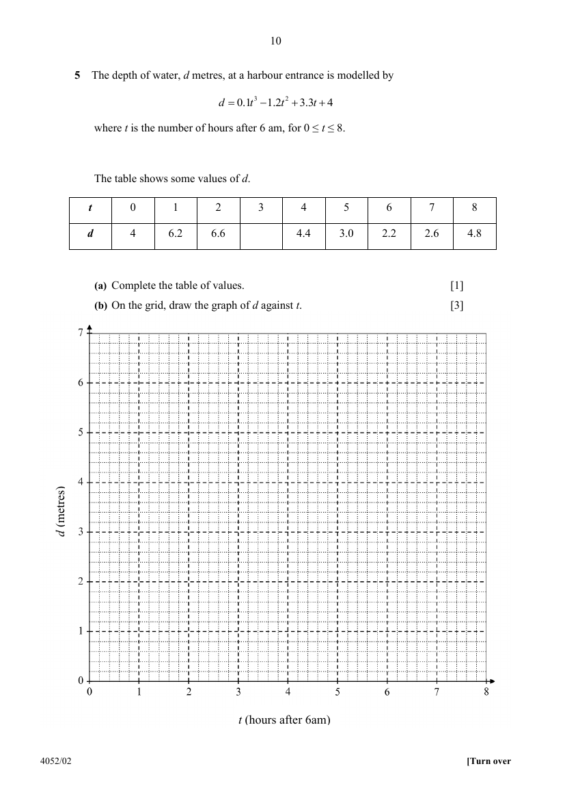

## Question

> **Marks:** (a) 1, (b) 3, (c)(i) 2, (c)(ii) 1, (d) 1, (e) 2; total 10
> **Page:** 10–11

The depth of water, $d$ metres, at a harbour entrance is modelled by

$$
d=0.1t^{3}-1.2t^{2}+3.3t+4
$$

where $t$ is the number of hours after $6$ am, for $0\leq t\leq 8$.

The table shows some values of $d$.

| $t$ | $0$ | $1$ | $2$ | $3$ | $4$ | $5$ | $6$ | $7$ | $8$ |
| --- | --- | --- | --- | --- | --- | --- | --- | --- | --- |
| $d$ | $4$ | $6.2$ | $6.6$ |  | $4.4$ | $3.0$ | $2.2$ | $2.6$ | $4.8$ |

**(a)** Complete the table of values. [1]

**(b)** On the grid, draw the graph of $d$ against $t$. [3]

**(c)**

**(i)** By drawing a tangent, find the gradient at $t=5$. [2]

**(ii)** Use your graph to find the minimum depth of water at the harbour entrance. [1]

**(d)** Use your graph to find the values of $t$ for which the depth of water is decreasing. [1]

**(e)** A cargo ship is being loaded at the quay. As loading continues, the depth of water the ship needs is modelled by $d=0.2t+2$. By drawing the line $d=0.2t+2$ on your grid, find the time by which the ship must leave in order to avoid becoming stranded. Give your answer as a time of day. [2]

## Answer Scheme

**(a)**

$$
d=0.1(3)^{3}-1.2(3)^{2}+3.3(3)+4=5.8
$$

**(b)** Plot the nine points from the table. Join them with a single smooth curve.

**(c)(i)** Draw a tangent to the curve at $t=5$. Gradient $\approx -1.2$ (accept $-1.0$ to $-1.4$).

**(c)(ii)** Minimum depth $\approx 2.2\text{ m}$ (at $t\approx 6.2$).

**(d)** Depth is decreasing for $1.8<t<6.2$ (approx).

**(e)** Draw the line $d=0.2t+2$ on the grid. It meets the curve on the falling part at $t=5$.
$t=5$ is $5$ hours after $6$ am, so the ship must leave by $11$ am.
