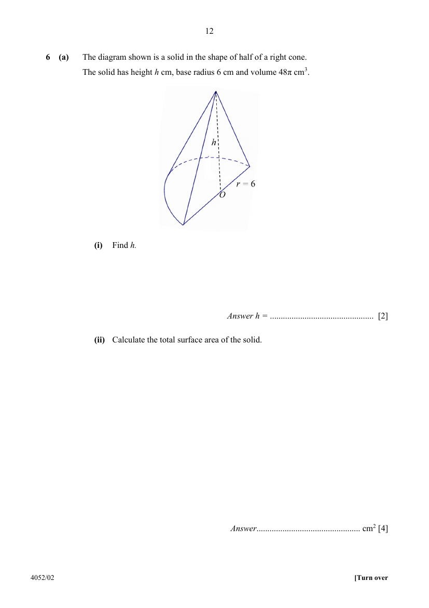

## Question

> **Marks:** (a)(i) 2, (a)(ii) 4, (b) 3; total 9
> **Page:** 12–13

**(a)** The diagram shown is a solid in the shape of half of a right cone.
The solid has height $h\text{ cm}$, base radius $6\text{ cm}$ and volume $48\pi\text{ cm}^{3}$.

**(i)** Find $h$. [2]

**(ii)** Calculate the total surface area of the solid. [4]

**(b)** A company sells detergent in geometrically similar containers in two sizes.
The ratio of the height of the Large container to the height of the Small container is $3:2$.

The table shows the cost of producing one filled Small container.

| Component | Cost |
| --- | --- |
| Detergent | $\$3.20$ |
| Material for the container | $\$0.80$ |
| Printing the label | $\$0.15$ |

The cost of the detergent is proportional to the volume of the container.
The cost of the materials for the container is proportional to the surface area of the container.
Printing the label costs $\$0.15$ per container, regardless of size.
Calculate the total cost of producing one filled Large container. [3]

## Answer Scheme

**(a)(i)**

$$
\frac{1}{2}\times\frac{1}{3}\pi r^{2}h=48\pi
$$

$$
\frac{1}{2}\times\frac{1}{3}\pi(6)^{2}h=48\pi
$$

$$
6\pi h=48\pi
$$

$$
h=8\text{ cm}
$$

**(a)(ii)**

$$
l=\sqrt{6^{2}+8^{2}}=10\text{ cm}
$$

$$
\text{Half curved surface}=\frac{1}{2}\pi rl=\frac{1}{2}\pi(6)(10)=30\pi
$$

$$
\text{Half base}=\frac{1}{2}\pi r^{2}=\frac{1}{2}\pi(6)^{2}=18\pi
$$

$$
\text{Triangular face}=\frac{1}{2}(12)(8)=48
$$

$$
\text{Total surface area}=30\pi+18\pi+48=199\text{ cm}^{2}
$$

**(b)**

$$
\text{Detergent}=3.20\times\left(\frac{3}{2}\right)^{3}=3.20\times\frac{27}{8}=\$10.80
$$

$$
\text{Material}=0.80\times\left(\frac{3}{2}\right)^{2}=0.80\times\frac{9}{4}=\$1.80
$$

$$
\text{Total}=10.80+1.80+0.15=\$12.75
$$
