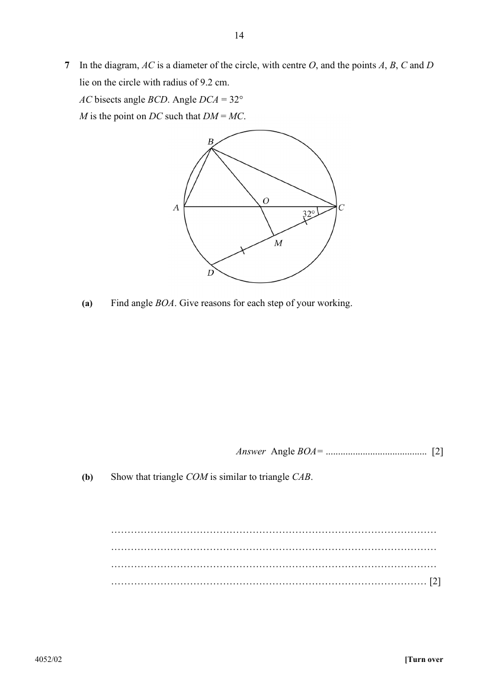

## Question

> **Marks:** (a) 2, (b) 2, (c) 2, (d) 2; total 8
> **Page:** 14–15

In the diagram, $AC$ is a diameter of the circle, with centre $O$, and the points $A$, $B$, $C$ and $D$ lie on the circle with radius of $9.2\text{ cm}$.
$AC$ bisects angle $BCD$. Angle $DCA=32^{\circ}$.
$M$ is the point on $DC$ such that $DM=MC$.

**(a)** Find angle $BOA$. Give reasons for each step of your working. [2]

**(b)** Show that triangle $COM$ is similar to triangle $CAB$. [2]

**(c)** Show that $BC=DC$. [2]

**(d)** Find the shortest distance of $BC$ from $O$. [2]

## Answer Scheme

**(a)** $\angle BCA=32^{\circ}$ ($AC$ bisects $\angle BCD$)

$$
\angle BOA=2\times 32^{\circ}=64^{\circ}
$$

($\angle$ at centre $=2\times\angle$ at circumference)

**(b)** $O$ and $M$ are the midpoints of $AC$ and $DC$, so $OM\parallel AD$ (midpoint theorem).

$\angle OMC=\angle ADC=90^{\circ}$ (corr. $\angle$s, $OM\parallel AD$; $\angle$ in semicircle)

$\angle OCM=\angle ACB=32^{\circ}$ ($AC$ bisects $\angle BCD$)

$\therefore \triangle COM$ is similar to $\triangle CAB$ ($2$ pairs of equal angles)

**(c)** In $\triangle ABC$ and $\triangle ADC$:

$\angle ABC=\angle ADC=90^{\circ}$ ($\angle$ in semicircle)

$\angle BCA=\angle DCA=32^{\circ}$ ($AC$ bisects $\angle BCD$)

$AC$ is common.

$\therefore \triangle ABC\equiv\triangle ADC$ (AAS)

$\therefore BC=DC$

**(d)**

$$
BC=18.4\cos 32^{\circ}=15.60\text{ cm}
$$

The perpendicular from $O$ bisects $BC$, so the half-chord $=7.802\text{ cm}$.

$$
d=\sqrt{9.2^{2}-7.802^{2}}=4.88\text{ cm (3 s.f.)}
$$
