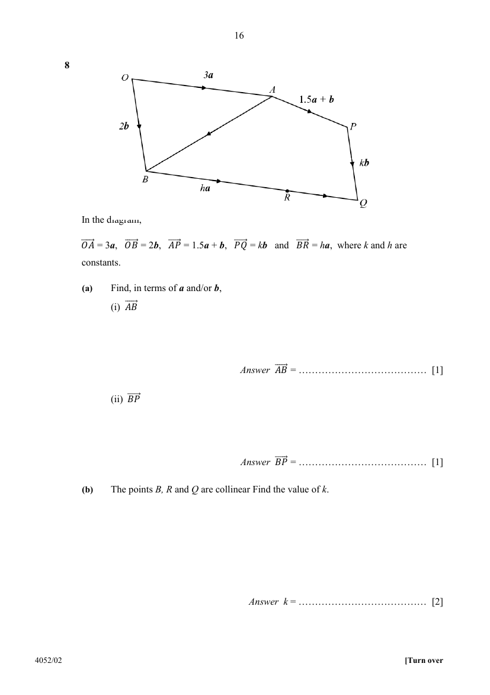

## Question

> **Marks:** (a)(i) 1, (a)(ii) 1, (b) 2, (c) 3, (d) 2, (e) 2; total 11
> **Page:** 16–17

In the diagram,

$\overrightarrow{OA}=3\mathbf{a}$, $\overrightarrow{OB}=2\mathbf{b}$, $\overrightarrow{AP}=1.5\mathbf{a}+\mathbf{b}$, $\overrightarrow{PQ}=k\mathbf{b}$ and $\overrightarrow{BR}=h\mathbf{a}$, where $k$ and $h$ are constants.

**(a)** Find, in terms of $\mathbf{a}$ and/or $\mathbf{b}$,

**(i)** $\overrightarrow{AB}$ [1]

**(ii)** $\overrightarrow{BP}$ [1]

**(b)** The points $B$, $R$ and $Q$ are collinear. Find the value of $k$. [2]

**(c)** Given that $\overrightarrow{PR}$ is parallel to $\overrightarrow{AB}$, show that $h=3$. [3]

**(d)** Find $BR:RQ$, and hence describe the position of $R$ on $BQ$. [2]

**(e)** Given that the area of triangle $AOB$ is $60$ units$^{2}$, find the area of triangle $ABR$. [2]

## Answer Scheme

**(a)(i)** $\overrightarrow{AB}=2\mathbf{b}-3\mathbf{a}$

**(a)(ii)**

$$
\overrightarrow{BP}=\overrightarrow{BA}+\overrightarrow{AP}=(3\mathbf{a}-2\mathbf{b})+(1.5\mathbf{a}+\mathbf{b})=4.5\mathbf{a}-\mathbf{b}
$$

**(b)**

$$
\overrightarrow{OQ}=\overrightarrow{OA}+\overrightarrow{AP}+\overrightarrow{PQ}=3\mathbf{a}+(1.5\mathbf{a}+\mathbf{b})+k\mathbf{b}=4.5\mathbf{a}+(1+k)\mathbf{b}
$$

$$
\overrightarrow{BQ}=\overrightarrow{OQ}-\overrightarrow{OB}=4.5\mathbf{a}+(k-1)\mathbf{b}
$$

$\overrightarrow{BR}=h\mathbf{a}$ is parallel to $\mathbf{a}$, and $B$, $R$, $Q$ are collinear, so $\overrightarrow{BQ}$ is parallel to $\mathbf{a}$.

$\therefore$ coefficient of $\mathbf{b}=0$:

$$
k-1=0
$$

$$
k=1
$$

**(c)**

$$
\overrightarrow{OP}=3\mathbf{a}+(1.5\mathbf{a}+\mathbf{b})=4.5\mathbf{a}+\mathbf{b}
$$

$$
\overrightarrow{OR}=\overrightarrow{OB}+\overrightarrow{BR}=h\mathbf{a}+2\mathbf{b}
$$

$$
\overrightarrow{PR}=\overrightarrow{OR}-\overrightarrow{OP}=(h-4.5)\mathbf{a}+\mathbf{b}
$$

Since $\overrightarrow{PR}\parallel\overrightarrow{AB}$, $\overrightarrow{PR}=\lambda\overrightarrow{AB}$:

$$
(h-4.5)\mathbf{a}+\mathbf{b}=\lambda(2\mathbf{b}-3\mathbf{a})
$$

Comparing coefficients of $\mathbf{b}$:

$$
1=2\lambda
$$

$$
\lambda=\frac{1}{2}
$$

Comparing coefficients of $\mathbf{a}$:

$$
h-4.5=-3\lambda=-1.5
$$

$$
h=3
$$

**(d)** With $k=1$:

$$
\overrightarrow{RQ}=\overrightarrow{BQ}-\overrightarrow{BR}=4.5\mathbf{a}-3\mathbf{a}=1.5\mathbf{a}
$$

$$
BR:RQ=3:1.5=2:1
$$

$R$ lies on $BQ$, two-thirds of the way from $B$ to $Q$ ($BR$ is twice $RQ$).

**(e)**

$$
\overrightarrow{AR}=\overrightarrow{AB}+\overrightarrow{BR}=(2\mathbf{b}-3\mathbf{a})+3\mathbf{a}=2\mathbf{b}
$$

Since $\overrightarrow{AR}=2\mathbf{b}=\overrightarrow{OB}$ and $\overrightarrow{BR}=3\mathbf{a}=\overrightarrow{OA}$, $OARB$ is a parallelogram.
Diagonal $AB$ divides it into two equal triangles, $\triangle AOB$ and $\triangle ABR$.

$$
\text{Area of }\triangle ABR=\text{Area of }\triangle AOB=60\text{ units}^{2}
$$
