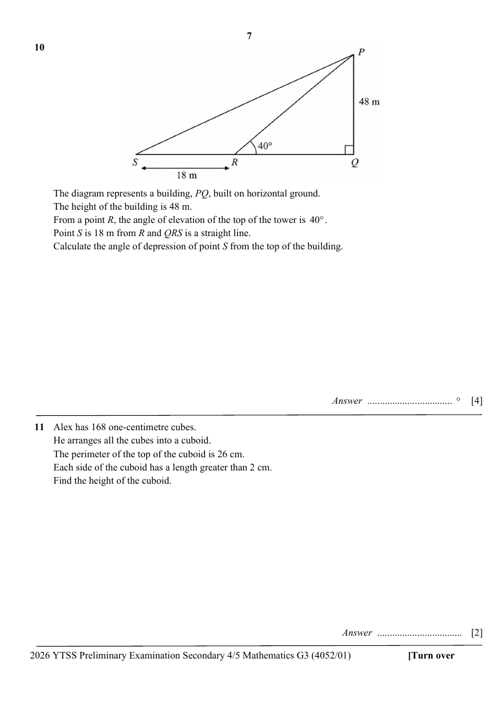

## Question

> **Marks:** 4
> **Page:** 7

The diagram represents a building, $PQ$, built on horizontal ground.
The height of the building is 48 m.
From a point $R$, the angle of elevation of the top of the tower is $40^{\circ}$.
Point $S$ is 18 m from $R$ and $QRS$ is a straight line.
Calculate the angle of depression of point $S$ from the top of the building. [4]
