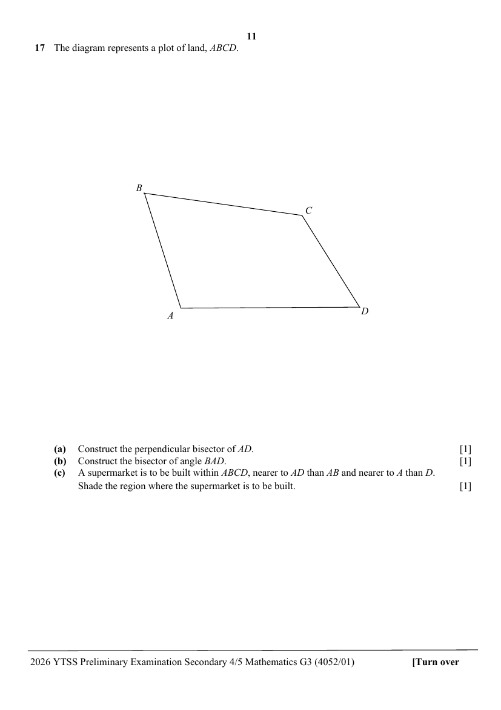

## Question

> **Marks:** (a) 1, (b) 1, (c) 1; total 3
> **Page:** 11

The diagram represents a plot of land, $ABCD$.

**(a)** Construct the perpendicular bisector of $AD$. [1]

**(b)** Construct the bisector of angle $BAD$. [1]

**(c)** A supermarket is to be built within $ABCD$, nearer to $AD$ than $AB$ and nearer to $A$ than $D$.
Shade the region where the supermarket is to be built. [1]
