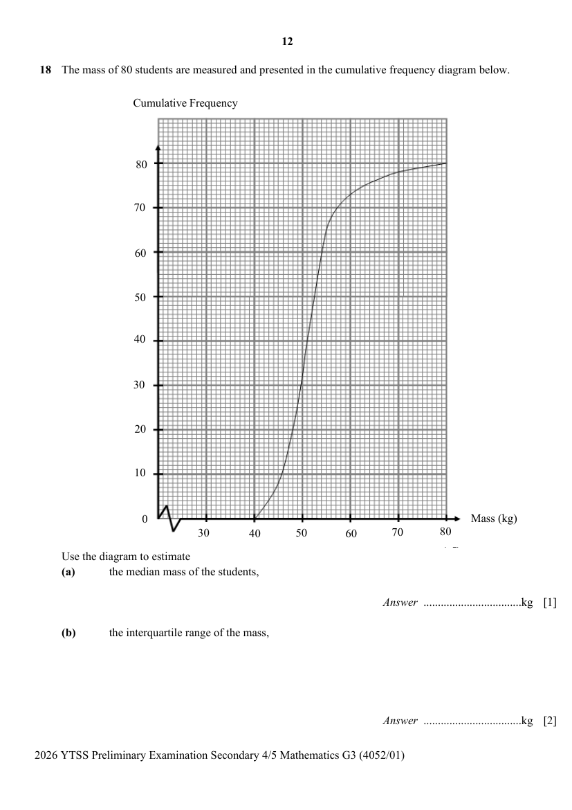

## Question

> **Marks:** (a) 1, (b) 2, (c) 1, (d) 2; total 6
> **Page:** 12–13

The mass of 80 students are measured and presented in the cumulative frequency diagram below.

Use the diagram to estimate

**(a)** the median mass of the students, [1]

**(b)** the interquartile range of the mass, [2]

**(c)** the percentage of students whose mass are at least 70 kg. [1]

**(d)** One student is chosen at random.
Find the probability that the student’s mass is between 45 kg and 65 kg. [2]
