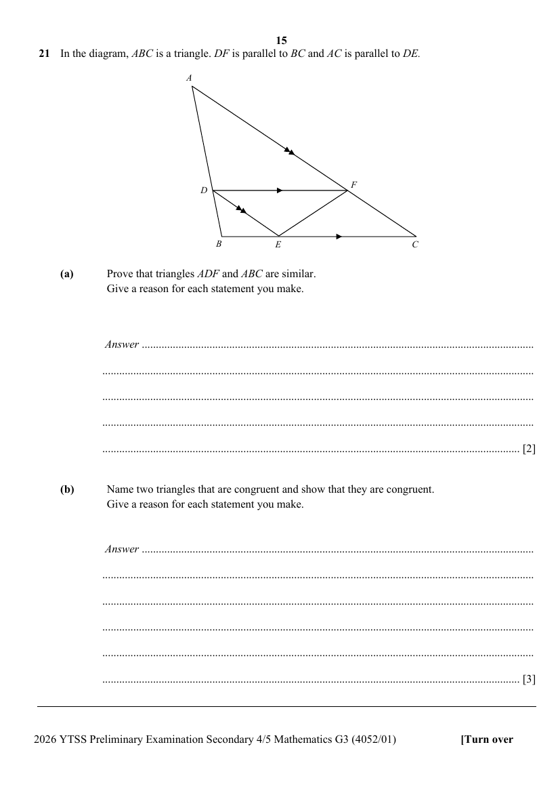

## Question

> **Marks:** (a) 2, (b) 3; total 5
> **Page:** 15

In the diagram, $ABC$ is a triangle. $DF$ is parallel to $BC$ and $AC$ is parallel to $DE$.

**(a)** Prove that triangles $ADF$ and $ABC$ are similar.
Give a reason for each statement you make. [2]

**(b)** Name two triangles that are congruent and show that they are congruent.
Give a reason for each statement you make. [3]
