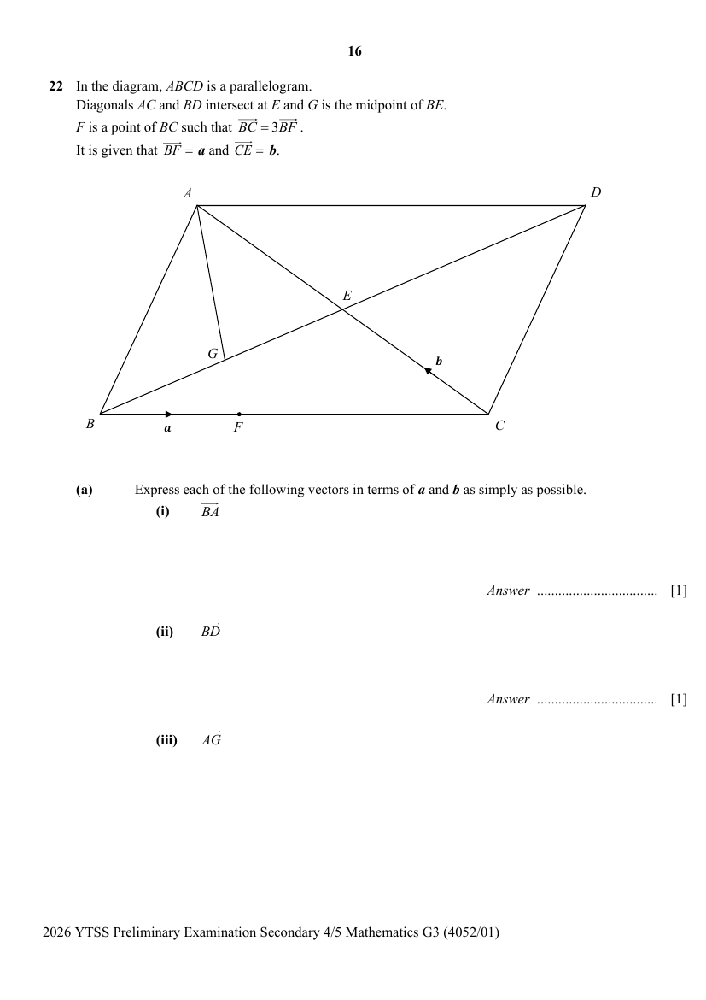

## Question

> **Marks:** (a)(i) 1, (a)(ii) 1, (a)(iii) 2, (b) 2, (c) 2; total 8
> **Page:** 16–17

In the diagram, $ABCD$ is a parallelogram.
Diagonals $AC$ and $BD$ intersect at $E$ and $G$ is the midpoint of $BE$.
$F$ is a point of $BC$ such that $\overrightarrow{BC}=3\overrightarrow{BF}$.
It is given that $\overrightarrow{BF}=\mathbf{a}$ and $\overrightarrow{CE}=\mathbf{b}$.

**(a)** Express each of the following vectors in terms of $\mathbf{a}$ and $\mathbf{b}$ as simply as possible.

**(i)** $\overrightarrow{BA}$ [1]

**(ii)** $\overrightarrow{BD}$ [1]

**(iii)** $\overrightarrow{AG}$ [2]

**(b)** Show that points $A$, $G$ and $F$ are collinear. [2]

**(c)** Find the value of $\dfrac{\text{area of }\triangle BFG}{\text{area of }ABCD}$. [2]
